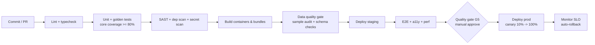
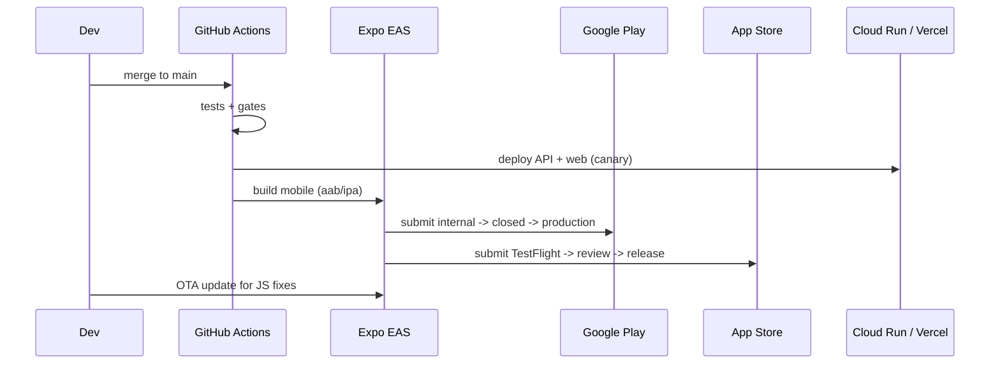

# 07 – Deployment & DevOps

## 1. Environments

| Env | Purpose | Hosting | Data |
| :-- | :-- | :-- | :-- |
| `local` | Developer machine | Docker Compose (Postgres, API, web), OmniRoute on `:20128` | Seed set (500 names) |
| `dev` | Integration | Cloud Run (scale-to-zero) + Supabase/Neon free DB | Synthetic + sample |
| `staging` | UAT, Six Sigma gate testing | Same as prod, smaller | Release candidate dataset |
| `prod` | Live | Cloud Run `asia-south1` + managed Postgres + Cloudflare | Verified dataset |

## 2. Repository layout (`app/`)

```text
app/
  apps/
    mobile/        # Expo React Native
    web/           # Next.js
    api/           # NestJS
    admin/         # Curator console (Next.js, RBAC)
  packages/
    core/          # numerology + nakshatra (pure TS, 100% tested)
    ui/            # shared components, tokens, Indic fonts
    schemas/       # zod/OpenAPI types shared by client & server
  data/
    pipeline/      # ingest -> normalise -> dedupe -> enrich scripts
    seeds/         # syllable tables, numerology mappings, taxonomies
  infra/           # Terraform/Pulumi, Dockerfiles, GitHub Actions
  tests/           # golden sets, e2e, load
```

## 3. CI/CD pipeline



* **GitHub Actions** (2,000 free min/month on private repos; unlimited for public).
* **Mobile:** EAS Build + EAS Submit; OTA via EAS Update for JS-only fixes; staged rollout 5% → 20% → 100% on Play, phased release on iOS.
* **Database migrations:** versioned (Prisma/Drizzle); backward-compatible (expand → migrate → contract).
* **Dataset releases:** immutable `names-YYYY.MM.N`, mobile snapshot built in CI and published to object storage + CDN.

## 4. Release flow – mobile & web



## 5. Store readiness checklist

| Item | Google Play | Apple App Store |
| :-- | :-- | :-- |
| Account | $25 one-time | $99/year |
| Privacy policy URL, DPDP notice | ✔ | ✔ |
| Data safety / privacy nutrition labels | ✔ | ✔ |
| Content rating (astrology/religion neutrality) | IARC | Age 4+/12+ |
| Screenshots in EN + HI + 2 regional | ✔ | ✔ |
| Testing | Closed test (12 testers × 14 days for new personal accounts) | TestFlight |
| Review time | hours–7 days | 1–3 days (plan buffer) |

## 6. Operations

| Area | Practice |
| :-- | :-- |
| Monitoring | Sentry (errors), Grafana Cloud/OpenTelemetry, uptime checks, Crashlytics |
| SLOs | API availability 99.5% → 99.9%; search p95 ≤ 300 ms; crash-free sessions ≥ 99.5% |
| Alerting | Error-rate, p95, queue depth, AI-fallback exhaustion, DB size |
| Backups | Daily DB backup (7–30 days), weekly export of verified dataset to object storage |
| DR | RPO 24 h, RTO 4 h (MVP) → RPO 1 h (v2) |
| Secrets | Secret Manager; never in repo; OmniRoute keys rotated quarterly |
| Support | In-app “report a problem”, email; triage SLA 48 h |
| Content ops | Weekly curator review meeting; monthly dataset release |

## 7. OmniRoute in deployment

* **Dev/CI data pipeline:** OmniRoute runs on a developer machine or a small always-on VM (≈ ₹500–900/month if cloud-hosted) bound to **loopback / private network with `REQUIRE_API_KEY=true`**.
* **Production user-facing AI:** call OmniRoute from a private network only, with budget caps; if free tiers are unavailable, fall back to a paid provider alias.
* See [doc 09](09-OmniRoute-AI-Usage-Plan.md).

