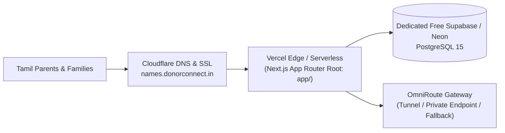

# Production Site Deployment Guide (`deployment/site`)

**Version:** 1.0 | **Date:** 2026-11-09 | **Target Domain:** `names.donorconnect.in` (Shared DonorConnect Infra Ecosystem)

---

## 1. Zero-Additional-Cost Production Topology

Per Milestone **M0 (Free-infra foundation)** in [`doc/plan/10-Roadmap-WBS.md`](../../plan/10-Roadmap-WBS.md), NamingGuru reuses the existing `donorconnect.in` cloud ecosystem with **₹0 incremental monthly hosting cost**:



---

## 2. Step-by-Step Site Deployment

### Step 1: Provision Dedicated Free PostgreSQL (Supabase or Neon)
1. Create a free project in **Supabase** (`ap-south-1` Mumbai) or **Neon**.
2. Open the SQL Editor and execute [`app/src/data/schema.sql`](../../../app/src/data/schema.sql) to create:
   - `tamil_names` (with `pg_trgm` GIN index)
   - `social_polls`
   - `public_suggestions`
   - `error_reports`
3. Copy the pooled PostgreSQL connection string (`DATABASE_URL`).

### Step 2: Deploy `app/` to Vercel
1. Import the repository into **Vercel** and set the **Root Directory** to `app`.
2. Configure the following Environment Variables in Vercel Project Settings:
   ```ini
   DATABASE_URL=postgresql://...
   OMNIROUTE_BASE_URL=https://your-omniroute-endpoint/v1
   OMNIROUTE_API_KEY=sk-...
   OMNIROUTE_DEFAULT_MODEL=auto/best-free
   NEXT_PUBLIC_ENABLE_ADS=true
   NEXT_PUBLIC_ENABLE_SUBSCRIPTION_PAYWALL=false
   NEXT_PUBLIC_SITE_URL=https://names.donorconnect.in
   ```
3. Click **Deploy**. Next.js will pre-render the static SEO name pages (`/name/[slug]`) and deploy the serverless API endpoints (`/api/*`).

### Step 3: Map Subdomain on Cloudflare (`donorconnect.in`)
1. Log in to the **Cloudflare Dashboard** managing `donorconnect.in`.
2. Add a `CNAME` record:
   - **Name**: `names`
   - **Target**: `cname.vercel-dns.com`
   - **Proxy status**: DNS only (or Proxied with Full Strict SSL)
3. Verify `https://names.donorconnect.in` is live.

### Step 4: Enabling Subscription Paywall Later (Milestone M5)
Once the ecosystem reaches your target subscriber threshold:
- Flip `NEXT_PUBLIC_ENABLE_SUBSCRIPTION_PAYWALL=true` in Vercel environment variables and redeploy.

