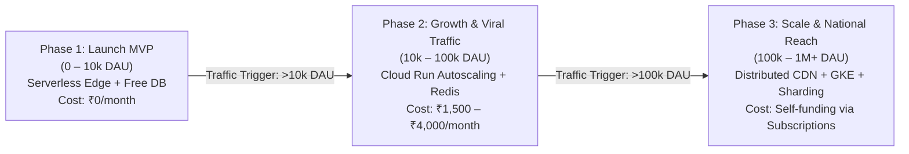
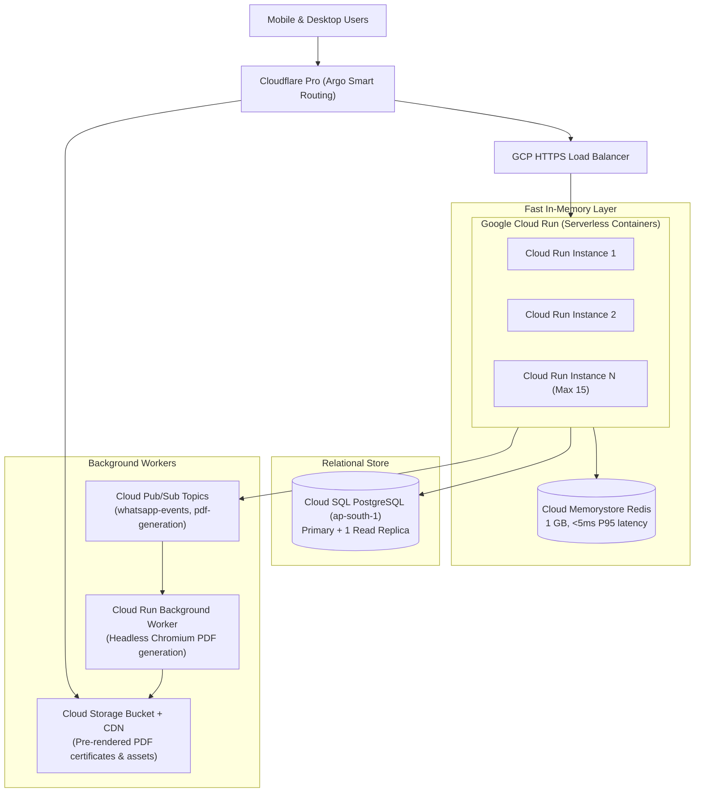
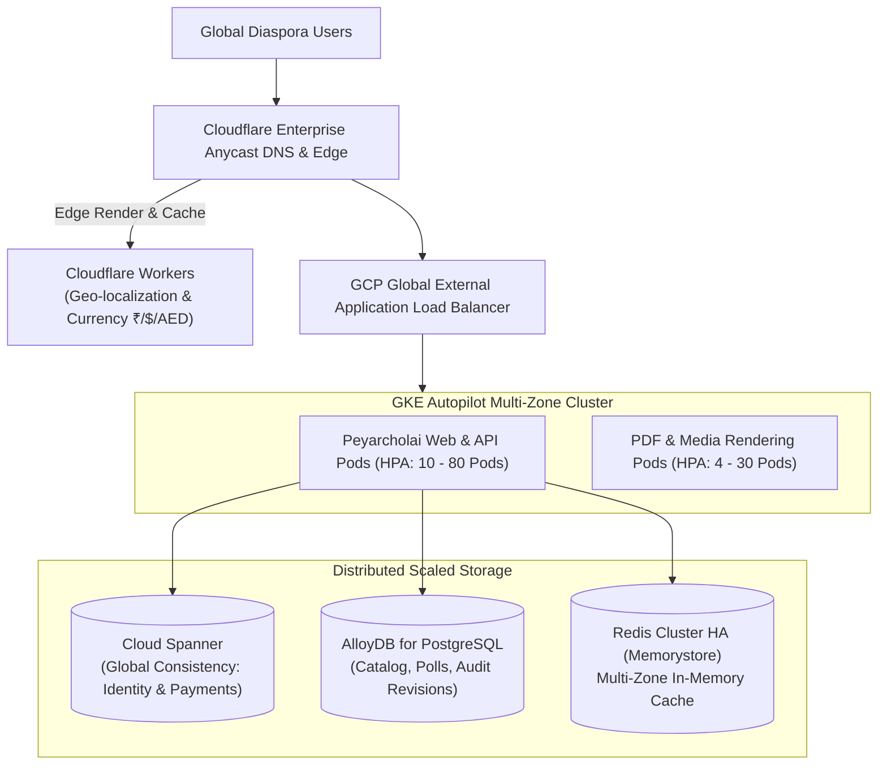

# Scalable Cloud Resources & Traffic Sizing Plan
## Production Infrastructure, Auto-Scaling Architecture & Resource Budgeting (Modeled after DonorConnect.in)

**Document Version:** 1.0  
**Target Application:** பெயர்ச்சோலை (Peyarcholai) — Classical Tamil Baby Names & Cultural Heritage Platform  
**Target Domain:** `peyarcholai.com` / `names.donorconnect.in`  
**Location:** `E:\project\Apps\KidNamingApp\doc\deployment\site\02-Scalable-Cloud-Resources-And-Traffic-Sizing-Plan.md`  
**Reference Model:** DonorConnect.in Evolutionary Architecture (`E:\project\donorconnect\doc-consolidated\Design\Design.md`)

---

## 1. Executive Summary & Evolutionary Scaling Philosophy

Similar to the three-tier architectural evolution established in **DonorConnect.in** (MVP $\rightarrow$ Beta $\rightarrow$ 5M DAU Target Scale), பெயர்ச்சோலை (Peyarcholai) follows an elastic, cost-aware deployment path designed to ensure **₹0 to minimal infrastructure overhead during launch**, while maintaining the technical headroom to seamlessly scale to **1 Million+ Daily Active Users (DAU)** with zero re-architecture.



---

## 2. Three-Phase Traffic Sizing & Resource Allocation Matrix

| Dimension | Phase 1: Launch & Discovery (0 – 10,000 DAU) | Phase 2: Growth & Subscriptions (10,000 – 100,000 DAU) | Phase 3: High-Scale Platform (100,000 – 1,000,000+ DAU) |
|:---|:---|:---|:---|
| **Peak QPS (Queries/Sec)** | 5 – 25 QPS | 50 – 250 QPS | 500 – 3,500 QPS |
| **Web & API Compute Tier** | Vercel Edge / Serverless Functions (Node.js 20, Next.js 16 App Router) | Google Cloud Run / Containerized Next.js (Autoscaling: min 2, max 15 instances) | Google Kubernetes Engine (GKE Autopilot) / Multi-region Pods with HPA |
| **Edge Network & CDN** | Cloudflare Free Tier (Universal SSL, Basic Caching, DDoS Protection) | Cloudflare Pro / Business Tier (Argo Smart Routing, Edge Workers, Custom SSL) | Cloudflare Enterprise + Google Cloud CDN (Anycast Geo-Routing, 99.99% SLA) |
| **Primary Relational DB** | Supabase Free / Neon Serverless Postgres (15.x, `ap-south-1` Mumbai) | Supabase Pro / Google Cloud SQL Postgres (2 vCPU, 8 GB RAM, Read Replica) | Google Cloud Spanner (Global Auth) + AlloyDB for PostgreSQL (Partitioned Catalog) |
| **In-Memory Cache Layer** | In-memory LRU Cache (Edge Memory) + Next.js Data Cache | Upstash Redis / Cloud Memorystore Redis (1 GB instance, <5ms read latency) | Redis Cluster (Memorystore HA, 10 GB, Multi-zone replication) |
| **Storage (PDFs & Assets)** | Supabase Storage / Local Shards (500 MB) | Google Cloud Storage (GCS Multi-Regional Bucket with signed download URLs) | Google Cloud Storage with Cloud CDN Edge Byte-Range Streaming |
| **Async Queues & Workers** | Serverless Background Promises (Next.js `after()` API) | Cloud Pub/Sub + Cloud Run Worker Service (WhatsApp polling webhooks & PDF render) | Cloud Pub/Sub + BullMQ on Redis Cluster + Dedicated GPU worker nodes |
| **AI Inference & LLMs** | Local HP Z4 Workstation (`100.105.146.7` via Tailscale) + OmniRoute Free | HP Z4 Workstation (Local 4-Model Suite) + OmniRoute Gateway Failover | OmniRoute Enterprise Pool (Hybrid: Local Workstation Clusters + Cloud APIs) |
| **Monthly Cloud Cost** | **₹0 (100% Free Tiers)** | **₹1,500 – ₹4,200 / month** | **Self-funding (~2-3% of subscription gross revenue)** |

---

## 3. Detailed Phase Specifications

### 3.1. Phase 1: Zero-Cost Serverless Launch (0 – 10k DAU)

```mermaid
flowchart TD
    User["Tamil Parents & Family Voters"] -->|HTTPS| CF["Cloudflare DNS & Edge Cache<br/>(SSL Full Strict)"]
    CF -->|Static Pages & Cache Hits| EdgeCache["Cloudflare Edge Cache<br/>(/name/[slug], /docs, static assets)"]
    CF -->|Dynamic API & SSR| Vercel["Vercel Serverless / Edge Runtime<br/>(Next.js 16 App Router)"]
    
    subgraph DataTier["Data & Cache Tier (Free)"]
        Vercel -->|Pooled Connection| NeonDB[("Neon / Supabase Serverless Postgres<br/>(ap-south-1 Mumbai)")]
        Vercel -->|Catalog Read (42 Shards)| LocalJSON["In-Memory Static Shards<br/>(Zero DB load for name exploration)"]
    end

    subgraph AITier["Linguistic AI Gateway"]
        Vercel -->|Tailscale Mesh / Private Tunnel| HP_Z4["HP Z4 Workstation (100.105.146.7)<br/>Ports 11434-11437 (AVX-512)"]
        Vercel -.->|Fallback| OmniRoute["OmniRoute AI Gateway (Local/Cloud)<br/>http://localhost:20128/v1"]
    end
```

#### Key Architecture Principles at Phase 1:
1. **Zero Database Load on Catalog Browsing:**
   The 21,350+ verified names are packaged into pre-compiled JSON shards in `src/data/names/`. 100% of Explorer pagination, starting-letter filters, and numerology lookups execute in-memory inside the Node.js / Edge process memory without touching PostgreSQL.
2. **PostgreSQL Used Exclusively for Dynamic State:**
   - User authentication sessions and subscription tokens (`user_entitlements`).
   - Collaborative WhatsApp family voting sessions (`social_polls` and `poll_votes`).
   - Correction suggestions and bug reports (`error_reports`).
3. **Local Workstation LLM Offload:**
   Linguistic advice requests (`/api/advisor`) route over encrypted Tailscale directly to the HP Z4 Workstation (`spark-x2.5-4b` on port `11434` or `qwen2.5-coder-14b` on port `11436`), keeping token costs strictly at **₹0.00**.

---

### 3.2. Phase 2: Growth & Subscriptions (10k – 100k DAU)

As viral WhatsApp voting links and SEO deep-dive pages drive steady organic acquisition:



#### Scaling Triggers & Configuration:
- **Cloud Run Autoscaling Policy:**
  - Min instances: `2` (eliminates cold starts).
  - Max instances: `15`.
  - Target concurrency per container: `80` concurrent requests.
  - CPU: `1 vCPU`, RAM: `2 GB` per container.
- **Redis Cache-Aside Pattern:**
  - Cache dynamic 7D scorecards and numerology results: `TTL = 24 hours`.
  - Cache active WhatsApp poll leaderboards: `TTL = 30 seconds`.
  - Session tokens and entitlement checks: `TTL = 15 minutes`.
- **Asynchronous PDF Generation:**
  High-resolution 300 DPI A4 palm-leaf keepsake certificates for ₹49 and ₹499 subscribers are generated via background workers and saved to Cloud Storage with temporary signed URLs, preventing web request timeouts.

---

### 3.3. Phase 3: High-Scale Platform (100k – 1M+ DAU)

At national scale across the global Tamil diaspora (India, Sri Lanka, Malaysia, Singapore, UAE, UK, US, Canada):



#### Key Architecture Principles at Phase 3:
1. **Edge-Driven Localization:**
   Cloudflare Workers detect user locale:
   - India: Displays ₹ pricing, UPI/Razorpay payment rails.
   - International diaspora: Displays local currency ($ / AED / SGD / MYR / £) with Stripe / Apple Pay / Google Pay.
2. **AlloyDB with Columnar Engine:**
   Analytical queries across millions of poll votes and parent search histories execute 100x faster than traditional PostgreSQL without degrading transaction throughput.
3. **Database Sharding:**
   Catalog shard partitioning by starting syllable and phonological class.

---

## 4. Resource Sizing & Capacity Equations

### 4.1. Network Bandwidth Calculation
For $N = 50,000$ Daily Active Users with an average session of 6 pageviews:
$$\text{Total Daily Requests} = 50,000 \times 6 = 300,000 \text{ requests/day}$$
$$\text{Average QPS} = \frac{300,000}{86,400} \approx 3.5 \text{ QPS}$$
$$\text{Peak QPS (Peak Factor } 4\times\text{)} = 3.5 \times 4 \approx 14 \text{ QPS}$$

- With an average compressed payload size of $35\text{ KB}$ per API request:
  $$\text{Peak Bandwidth} = 14 \text{ QPS} \times 35 \text{ KB} = 490 \text{ KB/s} \approx 3.92 \text{ Mbps}$$
- Cloudflare CDN edge caching absorbs **~85% of static assets and pre-rendered name dossiers**, dropping origin load to $< 2.1\text{ QPS}$ during peak hours.

### 4.2. Database Connection Pooling Sizing
Using Prisma / Supabase connection pooling (PgBouncer):
$$\text{Max Pool Size} = (\text{Total Cores} \times 2) + \text{Effective Spindle Count}$$
- On Cloud SQL (2 vCPU instance): `Pool Size = (2 * 2) + 1 = 5` connections per container.
- With 4 active Cloud Run containers: Total active DB connections = `20` (well within PostgreSQL's default limit of 100).

---

## 5. High-Availability, Failover & Disaster Recovery (DR)

| Failure Scenario | Automated Recovery Action | RTO (Recovery Time) | RPO (Data Loss Window) |
|:---|:---|:---:|:---:|
| **Local HP Z4 Host Unreachable** | OmniRoute automatically fails over to cloud provider (`auto/best-free` or `ddgw/gpt-4o-mini`). | $< 500\text{ ms}$ | 0 seconds |
| **Primary PostgreSQL Failure** | Cloud SQL automated failover replica promoted to master in zone `ap-south-1b`. | $< 60\text{ seconds}$ | 0 seconds (Synchronous replication) |
| **Container Crash / OOM** | Cloud Run / GKE health check (`/api/metrics`) fails; container terminated and replaced immediately. | $< 5\text{ seconds}$ | 0 seconds |
| **Complete Region Outage (`ap-south-1`)** | Multi-region DNS failover to Vercel global edge with read-only catalog backup. | $< 3\text{ minutes}$ | 0 seconds for catalog |

---

## 6. Implementation Action Plan

1. **Phase 1 Deployment (Immediate):**
   - Host `app/` on Vercel with Cloudflare DNS (`names.donorconnect.in` / `peyarcholai.com`).
   - Neon / Supabase serverless PostgreSQL for user tables.
   - Keep 21,350+ name records packaged in-memory.
2. **Phase 2 Transition (At 10,000 DAU):**
   - Containerize Next.js via Docker (`app/Dockerfile`).
   - Deploy to GCP Cloud Run in region `asia-south1` (Mumbai).
   - Attach Upstash / Memorystore Redis instance.
3. **Phase 3 Transition (At 100,000 DAU):**
   - Deploy GKE Autopilot cluster and configure AlloyDB read replicas.
