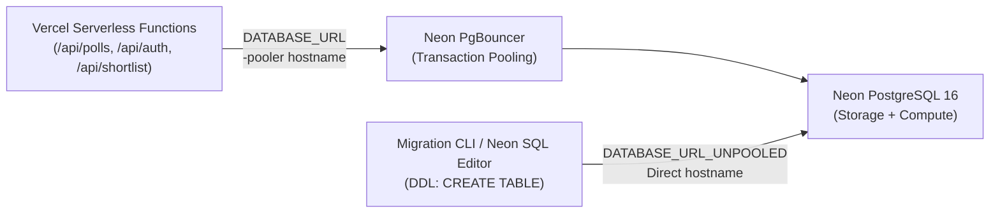

# 04 — Neon PostgreSQL (`DATABASE_URL` Pooled) Setup Guide (`B-07`)

**Document:** `doc/deployment/site/04-Neon-PostgreSQL-Database-Setup-Guide.md`  
**Unblocks:** [`doc/TODO/TODO.md`](../../TODO/TODO.md) — **B-07** (`Task 17B`, `T17-2`, `T17-3`, `T17-4`, `T20-4`)  
**Target Environment:** Vercel Serverless (`https://peyar.donorconnect.in`) + Local Dev (`app/.env.local`)  
**Cost Tier:** **$0 / month** (Neon Free Tier: `0.5 GB` storage, `190` compute hours/mo, built-in PgBouncer pooling)

---

## 1. Why Pooled vs. Direct Connection Strings Matter



1. **Runtime (`DATABASE_URL` — Pooled):** Next.js serverless routes on Vercel open and close connections per invocation. Without pooling, concurrent traffic exhausts PostgreSQL `max_connections`. Always use Neon's **`-pooler`** hostname for `DATABASE_URL`.
2. **Migrations (`DATABASE_URL_UNPOOLED` — Direct):** DDL scripts (`CREATE TABLE`, `ALTER TABLE`, advisory locks) should use the **direct** (non-`-pooler`) hostname or the Neon SQL Editor.

---

## 2. Step-by-Step Neon Setup (`$0` Free Tier)

1. Sign in to [https://console.neon.tech](https://console.neon.tech) (GitHub or Google SSO).
2. Click **Create a project**:
   - **Project name:** `peyarcholai-prod`
   - **Postgres version:** `16` (or `17`)
   - **Cloud provider & Region:** Select **AWS — Asia Pacific (Singapore) `ap-southeast-1`** (or **Mumbai** if available on your plan) for lowest latency to Indian users and Vercel `sin1`/`bom1` functions.
3. Click the green **`Connect`** button in the top-left sidebar (right under `peyarcholai-prod → production`, above `Overview`):
   - In the **Connect to your database** modal, make sure **Connection pooling** is **ON** (adds `-pooler` to the hostname).
   - Select **Database:** `neondb`, **Role:** `neondb_owner`, and **Connection string** (not Prisma/psql snippet), then copy it. It looks like:
     ```text
     postgresql://neondb_owner:<PASSWORD>@ep-cool-rain-123456-pooler.ap-southeast-1.aws.neon.tech/neondb?sslmode=require
     ```
   - Toggle **Connection pooling: OFF** and copy the direct URL as well (for migrations):
     ```text
     postgresql://neondb_owner:<PASSWORD>@ep-cool-rain-123456.ap-southeast-1.aws.neon.tech/neondb?sslmode=require
     ```

> [!CAUTION]
> **Never commit `DATABASE_URL` or passwords to Git.** Only `.env.local` (gitignored) and Vercel Environment Variables may hold real credentials.

---

## 3. Configure Local & Vercel Environments

### 3.1 Local Development (`E:\project\Apps\KidNamingApp\app\.env.local`)
Add the pooled URL to `app/.env.local`:

```env
# Pooled Neon URL for Next.js API routes (Task 17B / T17-2..4 / T20-4)
DATABASE_URL="postgresql://neondb_owner:<PASSWORD>@ep-cool-rain-123456-pooler.ap-southeast-1.aws.neon.tech/neondb?sslmode=require"

# Direct URL for running SQL schema migrations
DATABASE_URL_UNPOOLED="postgresql://neondb_owner:<PASSWORD>@ep-cool-rain-123456.ap-southeast-1.aws.neon.tech/neondb?sslmode=require"
```

### 3.2 Vercel Production & Preview (`peyar.donorconnect.in`)
1. Open **Vercel Dashboard → `Peyarcholai` Project → Settings → Environment Variables**.
2. Add **`DATABASE_URL`** with the **pooled (`-pooler`)** connection string:
   - Check **Production** and **Preview** (and **Development** if using `vercel env pull`).
3. *(Optional)* Add **`DATABASE_URL_UNPOOLED`** with the direct string if running migrations from CI.
4. Trigger a **Redeploy** so serverless functions pick up the new environment variable.

---

## 4. Initialize Database Schema (`T16-4` + `T17-2`)

Apply the platform core tables (`users`, `sessions`, `entitlements`) and app tables (`shortlists`, `polls`, `poll_votes`, `cohort_surveys`) using either:

### Option A: Neon Web SQL Editor (Fastest, Zero Local Tools)
1. Open **Neon Console → SQL Editor**.
2. Paste and run `E:\project\Apps\common\db\V1__users_sessions_entitlements.sql` (for `@platform/auth` tables).
3. Paste and run `app/src/lib/db/schema.sql` (once `T17-2` creates it) for `shortlists`, `polls`, and `poll_votes`.

### Option B: `psql` CLI
```powershell
psql "$env:DATABASE_URL_UNPOOLED" -f "E:\project\Apps\common\db\V1__users_sessions_entitlements.sql"
```

---

## 5. Verification Checklist & Troubleshooting

1. **Smoke-Test Connectivity:**
   ```powershell
   node -e 'import("pg").then(async ({Pool}) => { const p = new Pool({ connectionString: process.env.DATABASE_URL }); console.log((await p.query("SELECT 1 AS ok")).rows); await p.end(); })'
   ```
2. **Verify Production Guard (`T17-F4`):**
   - Previously, `NODE_ENV=production` without `DATABASE_URL` caused `/api/polls` to return `503` (`isProdMissingDb()`). Once `DATABASE_URL` is set in Vercel and redeployed, `/api/polls` connects to Neon instead of returning `503`.
3. **Common Pitfalls:**
   - **Missing `?sslmode=require`:** Neon rejects non-TLS connections. Always keep `sslmode=require` in the URL.
   - **Prepared Statements with PgBouncer:** If using `pg` in Node.js with Neon transaction pooling, avoid named prepared statements (`name` property on `query()`); standard parameterized queries (`$1, $2`) work out of the box.
   - **Cold-Start Wakeup:** Neon Free Tier suspends compute after 5 minutes of inactivity (~500ms–1s wakeup on the first query). Ensure API routes allow at least a `5s` connection timeout.

---

## 6. Next Step — Unblock `B-07` in `doc/TODO/TODO.md`
Once `DATABASE_URL` is saved in `app/.env.local` and Vercel:
1. Open [`doc/TODO/TODO.md`](../../TODO/TODO.md).
2. In **§0 Blocked (`B-07`)**, set **Your Answer** to `provided in .env.local + Vercel` and **Status** to `✅ Answered`.
3. This immediately unblocks **`T17-2`**, **`T17-3`**, **`T17-4`**, and **`T20-4`** for the next iteration.
