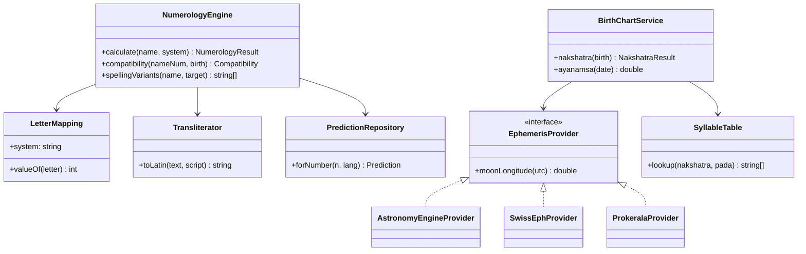

# 03 – Numerology & Horoscope Engine Specification

The engine is a **pure, deterministic TypeScript library (`@namingguru/core`)** shared by mobile, web and backend, so it runs **offline at zero server cost** and is easy to test (Six Sigma target: zero defects on golden tests).

## 1. Numerology systems supported

| System | Popularity in India | Letter mapping | Notes |
| :-- | :-- | :-- | :-- |
| **Chaldean** | Very high (Cheiro tradition) | A,I,J,Q,Y=1; B,K,R=2; C,G,L,S=3; D,M,T=4; E,H,N,X=5; U,V,W=6; O,Z=7; F,P=8 (9 is not assigned to letters) | Name total reduces to 1–9; compound numbers 10–52 carry their own meaning |
| **Pythagorean** | High (modern/English-medium) | A–I = 1–9, J–R = 1–9, S–Z = 1–8 | Standard Western |
| **Indian / Loshu / Vedic** | Medium | Uses Chaldean letter values with *Mulank* (birth day) and *Bhagyank* (full DOB) | Planet association (1 Sun … 9 Mars) |
| **Tamil / regional (Ankajyotish)** | Regional | Table configurable per tradition | Plug-in mapping (data-driven) |

Mappings are **data, not code** (`numerology_systems.json`) so alternate traditions can be added after expert review.

> **Corrections from the earlier study (`doc/01-Numerology-Methods.md`, see [doc 12](12-Input-Reconciliation.md)):**
> * Numerology (ank jyotish) in India is **not one codified tradition**; the popular systems derive from Chaldean and Pythagorean/Cheiro lineages adapted to Indian astrology. The “Indian/Vedic” and “Tamil/regional” rows above are therefore *adaptations*, not independent classical systems.
> * **Nakshatra-based naming is astrology, not numerology.** The app presents it as a separate feature (§3), though parents combine both.
> * **No standard exists for numeric values of Indic-script letters.** Native-script input is transliterated to Latin (§2); any direct Indic-script table must be expert-signed before use.
> * Interpretation text must be **original**, expert-reviewed per region (2–3 practising numerologists/astrologers), never copied from books.
> * Reference books (e.g. Sepharial *The Kabala of Numbers*, Cheiro’s *Book of Numbers*, classical Jyotish and Grihya Sutra sources) are **“verify edition/publisher before citing”**.
> * No health, financial or legal claims; always show the letter table and formula used, and state that methods can disagree.

### Planet–number association (Vedic)
1 Sun · 2 Moon · 3 Jupiter · 4 Rahu · 5 Mercury · 6 Venus · 7 Ketu · 8 Saturn · 9 Mars

## 2. Calculations

| Output | Formula |
| :-- | :-- |
| **Name number (Namank)** | Sum of letter values → reduce to a single digit (keep compound number too, e.g. 32/5) |
| **Birth number (Mulank)** | Day of birth reduced to 1–9 |
| **Destiny number (Bhagyank)** | Sum of all digits in DOB reduced to 1–9 |
| **Soul-urge** | Sum of vowels |
| **Personality** | Sum of consonants |
| **Compatibility** | Lookup matrix of Namank vs Mulank/Bhagyank → {Excellent, Good, Neutral, Caution} with reason text |
| **Lucky attributes** | From dominant planet: day, colour, gem, direction, mantra (cultural content, tagged by source) |

Reduction rule: repeat digit-sum until 1–9; keep master numbers 11/22/33 only in Pythagorean if user enables “master numbers”.

### Handling Indian names
* Input may be Devanagari/Tamil/etc. → **transliterate to Latin using a fixed scheme (ISO 15919 simplified)** → apply mapping. Show the transliteration used, and let the user edit (spelling variants change the number, e.g. “Aryan/Arian”).
* **Spelling-variant advisor:** suggest alternate spellings producing a favourable number while remaining phonetically identical.
* Full-name evaluation: first + middle + surname, plus initials-only view (common Indian practice).

## 3. Horoscope-aware naming

### 3.1 From birth data to nakshatra
Required: DOB, TOB, place of birth (lat/long/time-zone).
1. Convert local time → UTC (historical IST/time-zone offsets, incl. war-time & DST periods in IANA tzdata).
2. Compute **Moon’s tropical longitude** at that instant.
3. Subtract **Lahiri (Chitrapaksha) ayanamsa** → sidereal longitude.
4. `rashi = floor(L / 30°)`, `nakshatra = floor(L / 13°20′)`, `pada = floor((L mod 13°20′) / 3°20′) + 1`.
5. Lookup **starting syllables** (108 pada-syllables, Avakahada chakra) → suggest letters.

### Seed table – starting syllables per nakshatra (to be validated by a jyotishi)

| Nakshatra | Syllables | Nakshatra | Syllables |
| :-- | :-- | :-- | :-- |
| Ashwini | Chu, Che, Cho, La | Anuradha | Na, Ni, Nu, Ne |
| Bharani | Li, Lu, Le, Lo | Jyeshtha | No, Ya, Yi, Yu |
| Krittika | A, I, U, E | Mula | Ye, Yo, Bha, Bhi |
| Rohini | O, Va, Vi, Vu | Purva Ashadha | Bhu, Dha, Pha, Dha |
| Mrigashira | Ve, Vo, Ka, Ki | Uttara Ashadha | Be, Bo, Ja, Ji |
| Ardra | Ku, Gha, Ng, Chha | Shravana | Khi, Khu, Khe, Kho |
| Punarvasu | Ke, Ko, Ha, Hi | Dhanishta | Ga, Gi, Gu, Ge |
| Pushya | Hu, He, Ho, Da | Shatabhisha | Go, Sa, Si, Su |
| Ashlesha | Di, Du, De, Do | Purva Bhadrapada | Se, So, Da, Di |
| Magha | Ma, Mi, Mu, Me | Uttara Bhadrapada | Du, Tha, Jha, Na |
| Purva Phalguni | Mo, Ta, Ti, Tu | Revati | De, Do, Cha, Chi |
| Uttara Phalguni | Te, To, Pa, Pi | Hasta | Pu, Sha, Na, Tha |
| Chitra | Pe, Po, Ra, Ri | Swati | Ru, Re, Ro, Ta |
| Vishakha | Ti, Tu, Te, To | | |

Regional variants exist (e.g. South Indian vs North Indian syllable sets); the table is configurable per tradition.

### 3.2 Other tradition-specific naming aids

| Tradition | Feature |
| :-- | :-- |
| Sikh | **Naam Karan**: random Hukamnama/Gurbani opening letter → names starting with that letter (user enters letter; app lists Sikh names) |
| Muslim | Names with Arabic root & meaning, “Asma-ul-Husna”, avoid disputed meanings; Abjad numerology optional (Ilm-ul-Adad) |
| Christian | Saint/biblical names with feast day, patron saints |
| Jain / Buddhist / Parsi | Tradition-specific lists and letter conventions |
| Hindu | Nakshatra letters, Rashi letters, Kuladevata / grandparent name, Ashtakoota (36-point) matching where parents’ details are supplied |

### 3.3 Astronomical computation – licensing-aware options

| Option | Accuracy | Licence / cost | Offline | Verdict |
| :-- | :-- | :-- | :-- | :-- |
| **A. MIT-licensed astronomy library** (e.g. `astronomy-engine`) for Moon position + own Lahiri ayanamsa | Moon ≈ arc-minute – ample for nakshatra/pada (3°20′) | MIT, free | ✅ | **Chosen for MVP** (only Moon needed) |
| B. Swiss Ephemeris (`swisseph`/`pyswisseph`) | Gold standard | **AGPL-3.0**, or commercial licence (≈ CHF 700+) | ✅ | Needed only for full Kundli (planets, houses, dashas). Buy licence before closed-source launch of that feature |
| C. Prokerala / AstrologyAPI (managed APIs) | Full kundli, matching, panchang | Free 5k credits/mo (Prokerala); paid ≈ ₹1.7–3.4k/mo (100k credits) | ❌ | Optional for v1 premium features; cache results |
| D. Own Meeus-based implementation | Good | Own IP | ✅ | Backup if A is insufficient |

Boundary edge-case: Moon near a pada boundary (< 5′) → show both syllable sets with a note (“consult your pandit”).

## 4. Predictions content

Predictions are **authored content**, not AI-improvised, to keep correctness and avoid harmful statements.

| Content block | Source | Review |
| :-- | :-- | :-- |
| Number 1–9 + compound 10–52 meaning | Public-domain Cheiro texts + rewritten text | Numerologist reviewer |
| Planet, colour, gem, day, mantra | Traditional references | Jyotishi reviewer |
| Compatibility matrix 9×9 | Panel consensus | Two reviewers, disagreements flagged |
| Tone guide | “Tendencies”, never fear-inducing, no health/death predictions | Editorial policy (doc 11) |

LLM (via OmniRoute) may *paraphrase to regional languages* and *draft*, but outputs go through reviewer approval and are versioned.

## 5. Public API (core library)

```ts
numerology(name: string, opts: { system: 'chaldean'|'pythagorean'|'vedic'; scheme?: string }): NumerologyResult
birthNumbers(dob: Date): { mulank: number; bhagyank: number }
compatibility(nameNum: number, birth: BirthNumbers): Compatibility
nakshatra(birth: { utc: Date; lat: number; lon: number }): { rashi: Rashi; nakshatra: Nakshatra; pada: 1|2|3|4; syllables: string[] }
spellingVariants(name: string, target: number): string[]
```

## 6. Class diagram



## 7. Validation strategy
* 500+ **golden test cases** (name → expected number per system) cross-checked by two numerologists.
* Nakshatra tests against 200 published panchang entries and Prokerala outputs (tolerance: 100% nakshatra match; pada ≥ 99%).
* Property tests: reduction always 1–9; transliteration idempotent; mapping covers A–Z.

