# 04 – Data Model & Taxonomy

## 1. Classification dimensions

| Dimension | Type | Cardinality | Notes |
| :-- | :-- | :-- | :-- |
| `gender` | enum | 1 | boy / girl / unisex |
| `religion` | ref | 1..n | A name can be shared (e.g. “Arjun” Hindu & Sikh) |
| `language` | ref | 1..n | Origin language(s) |
| `community` | ref | 0..n | Expert-tagged only |
| `region` / `state` | ref | 0..n | Where predominantly used |
| `theme` | ref | 0..n | Meaning themes |
| `trend_class` | enum | 1 | classic / evergreen / rising / modern / rare |
| `ease_score` | 1–5 | 1 | Computed (see §4) |
| `starting_letter` | derived | 1 | Per script |
| `nakshatra_syllable` | derived | 0..n | From first syllable |
| `numerology_numbers` | derived | per system | Chaldean, Pythagorean |
| `syllable_count` | derived | 1 | |

## 2. ER diagram

```mermaid
erDiagram
    NAME ||--o{ NAME_SCRIPT : "written in"
    NAME ||--o{ NAME_MEANING : "has"
    NAME ||--o{ NAME_SOURCE : "cited by"
    NAME }o--o{ RELIGION : "used by"
    NAME }o--o{ LANGUAGE : "origin"
    NAME }o--o{ COMMUNITY : "tagged"
    NAME }o--o{ STATE : "popular in"
    NAME }o--o{ THEME : "about"
    NAME ||--o{ NAME_NUMEROLOGY : "computed"
    NAME ||--o{ NAME_TREND : "history"
    NAME ||--o{ NAME_VARIANT : "variant of"
    NAME ||--o{ REVIEW_TASK : "reviewed in"
    SOURCE ||--o{ NAME_SOURCE : "provides"
    USER ||--o{ SHORTLIST : "owns"
    SHORTLIST ||--o{ SHORTLIST_ITEM : "contains"
    NAME ||--o{ SHORTLIST_ITEM : "listed"
    USER ||--o{ BIRTH_PROFILE : "has"
    USER ||--o{ SUGGESTION : "submits"
    CURATOR ||--o{ REVIEW_TASK : "performs"
    NAME ||--o{ NAME_REFERENCE : "cited in"
    NAME ||--o{ NAME_FREQUENCY : "counted in"
    SHORTLIST ||--o| POLL : "published as"
    POLL ||--o{ POLL_VOTE : "receives"
    POLL_VOTE ||--o{ POLL_VOTE_ITEM : "marks"
    NAME ||--o{ POLL_VOTE_ITEM : "voted on"
    NAME_REFERENCE {
        uuid id PK
        uuid name_id FK
        string work "e.g. Mahabharata"
        string locator "chapter/verse or page"
        string edition
    }
    NAME_FREQUENCY {
        uuid name_id FK
        string region
        string community
        smallint year
        int count
        string source_id
    }
    POLL {
        uuid id PK
        uuid shortlist_id FK
        string token "unguessable link"
        timestamp closes_at
        enum visibility "private"
    }
    POLL_VOTE {
        uuid id PK
        uuid poll_id FK
        string voter_label "optional"
        string segment "family|friend"
        timestamp consent_at
    }
    POLL_VOTE_ITEM {
        uuid vote_id FK
        uuid name_id FK
        enum action "remove|love"
        enum reason "pronounce|misspell|meaning|common_rare|family_clash|numerology|nickname|dislike|other"
        text comment
    }

    NAME {
        uuid id PK
        string canonical_latin
        string phonetic_key
        enum gender
        enum status "candidate|reviewed|verified|rejected"
        smallint ease_score
        enum trend_class
        smallint syllables
        float confidence
        timestamp updated_at
    }
    NAME_SCRIPT {
        uuid id PK
        uuid name_id FK
        string script "Deva|Taml|Telu|Knda|Mlym|Beng|Gujr|Guru|Orya|Arab|Latn"
        string text
        string ipa
        string audio_url
    }
    NAME_MEANING {
        uuid id PK
        uuid name_id FK
        string lang
        text meaning
        string origin_root
        string citation
        string reviewer_id
    }
    SOURCE {
        uuid id PK
        string title
        string url
        string licence
        date retrieved_on
        enum trust_tier
    }
    NAME_NUMEROLOGY {
        uuid name_id FK
        string system
        smallint compound
        smallint reduced
    }
    BIRTH_PROFILE {
        uuid id PK
        uuid user_id FK
        date dob
        time tob
        string place
        string nakshatra
        smallint pada
        string rashi
    }
    USER {
        uuid id PK
        string auth_provider
        string locale
        timestamp consent_at
    }
    SHORTLIST {
        uuid id PK
        uuid user_id FK
        string title
    }
    REVIEW_TASK {
        uuid id PK
        uuid name_id FK
        enum state
        string notes
    }
```

> **Privacy:** `BIRTH_PROFILE` is optional, encrypted at column level and **stored on-device by default**; server sync only with consent (doc 11).

## 3. Search & ranking

| Concern | Design |
| :-- | :-- |
| Fuzzy / transliteration-tolerant | `pg_trgm` + phonetic key (Double Metaphone variant tuned for Indic transliteration: collapse `aa/a`, `ee/i`, `sh/s`, `th/t`, `v/w`, `z/j`) |
| Native script search | Index each `NAME_SCRIPT.text` |
| Meaning search | Postgres FTS on meaning + synonyms; semantic search via embeddings (`pgvector`) in v1.x |
| Ranking score | `0.35*filter_match + 0.20*meaning_match + 0.15*popularity + 0.10*ease + 0.10*numerology_fit + 0.10*freshness` (tunable, logged) |
| Scale | ≤ 150k names → PostgreSQL alone is sufficient; Typesense/Meilisearch only if p95 > 300 ms |
| Mobile | Ship a compressed **SQLite snapshot** of verified names (~15–25 MB for 60k) for offline browsing; delta sync weekly |

## 4. “Easy to call” score (1–5)

Computed from the pronunciation features; calibrated with a panel of 50 raters across regions.

| Feature | Weight | Rule |
| :-- | :-- | :-- |
| Syllable count | 25% | 2–3 best; ≥5 penalised |
| Hard clusters / retroflex-aspirate density | 25% | Penalty for “ksh, gnya, ndr”, repeated aspirates |
| Cross-language pronounceability | 25% | English-speaker and Hindi/South-Indian-speaker friendliness via IPA phoneme set |
| Unfortunate nickname / English-homophone check | 15% | Dictionary + LLM check, flagged for review |
| Spelling ambiguity | 10% | Number of plausible spellings |

## 5. Trend model

`trend_score = 0.4 * search_velocity + 0.3 * in-app favourites growth + 0.2 * media mentions + 0.1 * editorial` → mapped to `classic | evergreen | rising | modern | rare`. Recomputed monthly; **no personal data used**.

## 6. Versioning & lineage
* Every published record has `version`, `changed_by`, `change_reason` (audit table, supports SS-07 control plan).
* Dataset releases tagged `names-YYYY.MM.N` with a manifest hash; mobile snapshot references the release.

## 7. Evaluation scorecard mapping (from input `doc/03`)

| # | Dimension | Output | Computed from | MVP? | Notes |
| :-- | :-- | :-- | :-- | :-- | :-- |
| 1 | Pronunciation ease | 0–100 + syllables; scores for same-language and pan-India/international speakers | Phonotactic rules per language; maps to the 1–5 `ease_score` of §4 | Phase 2 | Subjective; calibrate with user feedback; TTS audio |
| 2 | Character count | Latin count, native **aksharas (grapheme clusters, not code points)**, syllables | Deterministic | **Yes** | Flag length limits for passport/Aadhaar/school forms |
| 3 | Meaning | Per-language meaning, `verified` flag, source; warn about unfortunate meanings in other languages | `NAME_MEANING` | **Yes** | AI drafts shown as “AI-suggested, not verified” |
| 4 | Historical / scriptural reference | Reference + locator + edition, else “No verified reference found” | `NAME_REFERENCE` | Partial | Curated only; never LLM-only claims |
| 5 | Family match | Initial/sound clash, rhyme, optional numerology harmony | User-entered family names (kept on device) | Phase 2 | Tradition rules configurable, never forced |
| 6 | Misspelling risk | Low/Med/High + likely variants + recommended official spelling | Variant generator + `NAME_VARIANT` | **Yes** | e.g. Krishna/Krushna/Krishnaa |
| 7 | Uniqueness | Band (very common / moderately common / rare) + percentile | `NAME_FREQUENCY`: `100 − percentile_popularity(name given region, language, community)` | Phase 3 | **Estimate** until partner frequency data exists |

Build order (from input): character count, misspelling, family-initial checks → meaning → pronunciation/TTS → uniqueness → references (ongoing curation).

Poll reason categories (enum above) are fixed so reasons can be aggregated; “3+ voters said unfortunate meaning” triggers a re-run of dimension 3 for that name.
