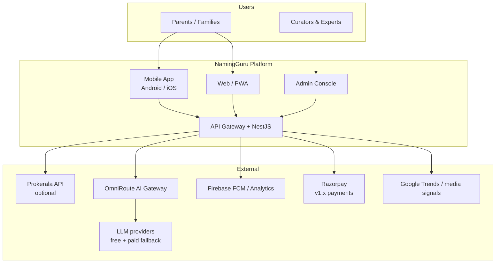
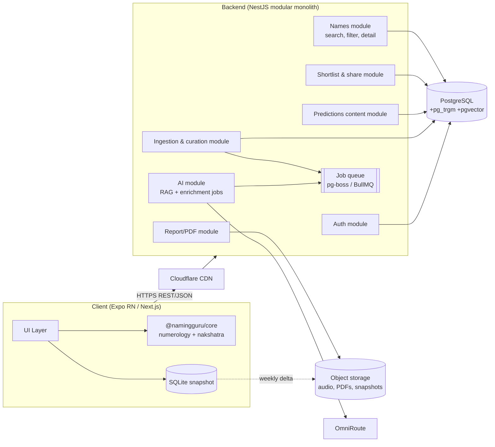
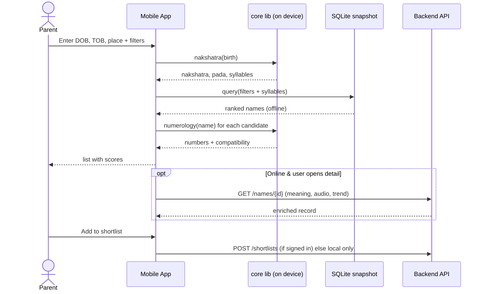
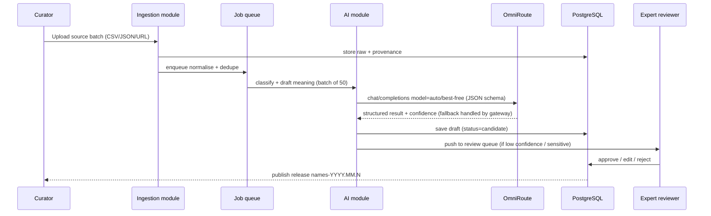
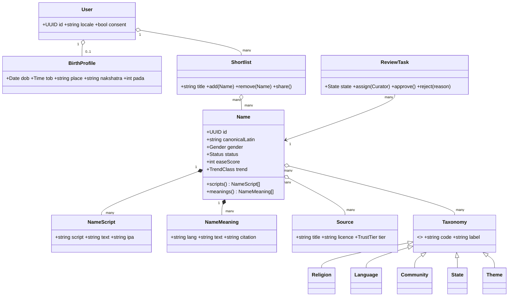
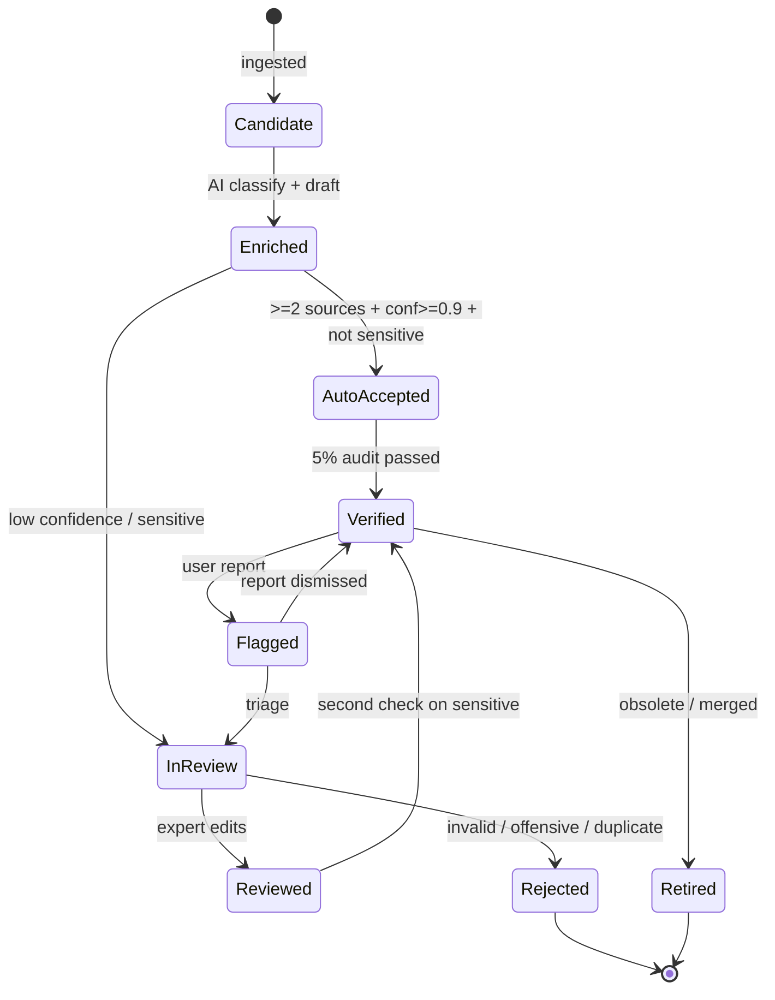
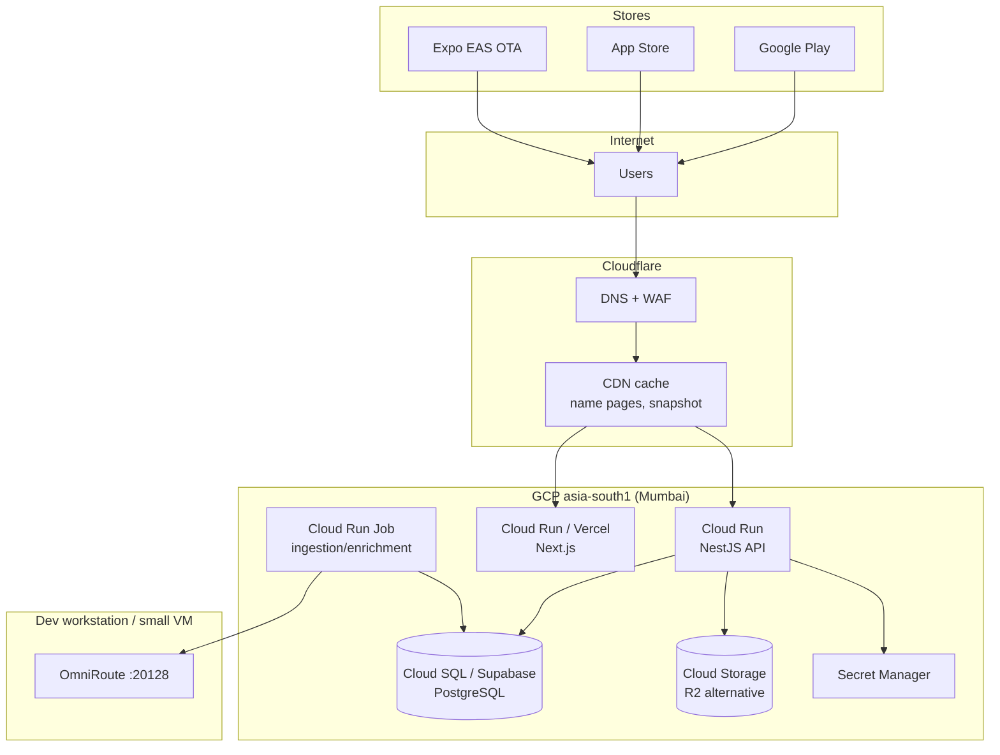
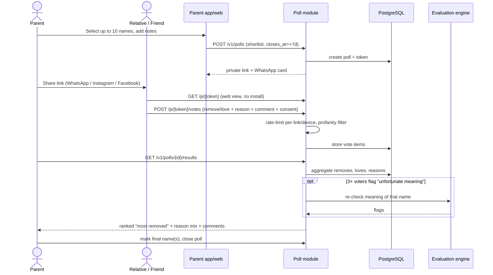

# 05 – Architecture & UML

## 1. Architecture decisions (ADR summary)

| ADR | Decision | Alternatives | Why |
| :-- | :-- | :-- | :-- |
| ADR-01 | **Monorepo (pnpm + Turborepo), TypeScript end-to-end** | Polyglot (Flutter + Python) | One shared core (numerology/nakshatra) for web, mobile, server; AI agents work well with a single language |
| ADR-02 | **Mobile: Expo / React Native** | Flutter, native | Shares TS core; OTA updates (EAS Update) cut store-release friction; one team |
| ADR-03 | **Web: Next.js (SSG/ISR) + PWA** | SPA | SEO for 150k name pages; fast on low-end phones |
| ADR-04 | **Backend: NestJS modular monolith** | Microservices | Small team, low cost; modules can be split later |
| ADR-05 | **DB: PostgreSQL** (+`pg_trgm`, FTS, `pgvector`) | Mongo, Elastic | Relational taxonomy, one engine for search; cheapest |
| ADR-06 | **Offline-first: SQLite snapshot on device** | Always online | India connectivity; near-zero server load for browsing |
| ADR-07 | **Numerology + nakshatra computed on device** | Server API | Zero latency, zero cost, privacy for birth data |
| ADR-08 | **AI via OmniRoute gateway** (OpenAI-compatible) | Direct vendor SDKs | Provider fallback, free-tier pooling, no vendor lock-in |
| ADR-09 | **Auth: Firebase Auth / Supabase Auth (phone OTP + Google)** | Custom | Phone OTP is the norm in India; login optional (guest mode) |
| ADR-10 | **Hosting: Cloud Run (asia-south1) or Fly.io Mumbai + Cloudflare** | VMs, k8s | Scale-to-zero, free tier |

## 2. System context

## 3. Container / component view

## 4. Sequence – name discovery with horoscope

## 5. Sequence – AI enrichment & verification pipeline

## 6. Domain class diagram

## 7. State diagram – name record lifecycle

## 8. Deployment view

## 9. API surface (v1 excerpt)

| Method | Path | Purpose |
| :-- | :-- | :-- |
| GET | `/v1/names?religion=&language=&state=&gender=&trend=&ease_min=&letter=&q=&nakshatra=&numerology=` | Filtered search |
| GET | `/v1/names/{id}` | Detail |
| GET | `/v1/snapshots/latest` | Offline DB manifest + signed URL |
| POST | `/v1/shortlists` · GET `/v1/shortlists/{id}` | Shortlist & share |
| POST | `/v1/suggestions` | UGC suggestion / error report |
| POST | `/v1/assistant/query` | RAG assistant (rate-limited) |
| POST | `/v1/admin/ingest` · `/v1/admin/review/{id}` | Curator workflows (RBAC) |

## 10. Cross-cutting concerns

| Concern | Approach |
| :-- | :-- |
| Security | JWT sessions, RBAC (user/curator/expert/admin), rate limiting, WAF, secrets in manager, dependency scanning |
| Observability | OpenTelemetry → Grafana Cloud free / Sentry; SLO dashboards (SS-07) |
| Config & feature flags | Remote config (Firebase) for rolling out regions/languages |
| i18n | ICU messages; Indic fonts bundled (Noto) for consistent rendering |
| Resilience | Offline-first client, CDN cache, retry/backoff, AI fallbacks via OmniRoute |

## 11. Social poll module (“vote out a name”)

Added from the earlier study (`doc/04-Social-Poll-Feature.md`). A new **Poll module** in the NestJS monolith; the voter experience is a lightweight public web page (no install, no login) reached by an unguessable token link, which also acts as the app’s viral loop.

Design rules (input doc 04): private by default; voters never see other comments; parent can delete comments; auto-close after N days; report button; deletion on request; retention limit. Privacy treatment in [doc 11 §6](11-Legal-Privacy-Ethics.md).

| Method | Path | Purpose |
| :-- | :-- | :-- |
| POST | `/v1/polls` | Create poll from shortlist |
| GET | `/p/{token}` | Public voter page (SSR, minimal data) |
| POST | `/p/{token}/votes` | Submit votes (rate-limited, consent flag) |
| GET | `/v1/polls/{id}/results` | Aggregated results (owner only) |
| DELETE | `/v1/polls/{id}/comments/{cid}` | Owner removes a comment |

Metrics: polls per active parent, voters per poll, comment rate, % polls ending with a final name, invite-to-install conversion.
