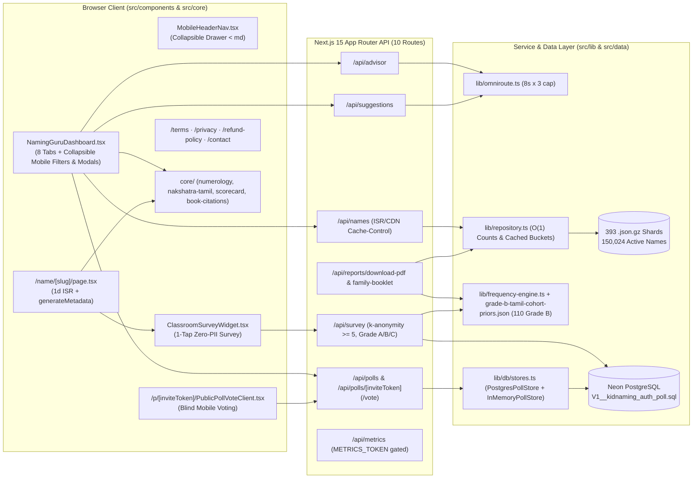

# Web MVP System Design (`app/`)

**Version:** 2.0 | **Date:** 2026-11-26 | **Branch:** `dev19Nov2026` | **Stack:** Next.js 15.5.29 (App Router, TypeScript) + Tailwind CSS (*Mangala Thottil* Theme) + OmniRoute AI (`v3.8.53`) + Neon PostgreSQL / Sharded `.json.gz` Hybrid

---

## 1. Component & Route Architecture (Synced via Graphify `1,754` nodes / `2,563` edges)

---

## 2. Database & Hybrid Persistence Design (`app/src/lib/db/V1__kidnaming_auth_poll.sql`)

- **Bundled Sharded Catalog (`app/src/data/names/*.json.gz`):** `150,024` active / `150,650` raw records across `393` gzipped shards (`22.94 MB`), cached in memory with `cachedAllNames`, `cachedAllCategoryBuckets`, `cachedSlugMap`, and throttled `statSync` (`< 30ms` single-pass filter latency).
- **Neon PostgreSQL (`DATABASE_URL` pooled, `B-07`):**
  - `polls` & `poll_votes` (`PostgresPollStore` with `creator_secret_hash`, `voter_token_hash` upsert, `MAX 10` candidates, `MAX 50` voters, 30-day post-close retention).
  - `class_collision_surveys` (anonymous zero-PII observations; `k-anonymity >= 5` threshold; upgrades name to **Grade A** at `>= 30` responses).
  - Graceful `try/catch` degradation on `/p/[inviteToken]`, `/api/polls/[inviteToken]`, and `/api/survey` ensures zero HTTP `500`s even before `V1` SQL migration runs.
- **Grade B External Cohort Priors (`app/src/data/grade-b-tamil-cohort-priors.json`):** `110` audited Tamil & South Indian first names (`bandWidthFactor.gradeB = 1.8`), seamlessly superseded by Grade A when live survey responses reach `>= 30`.

---

## 3. Caching, Security & Mobile-First Guardrails

1. **Performance & SEO (`122` Next.js Routes):**
   - `/` uses `revalidate = 3600` (`INITIAL_PAGE_SIZE = 24`, ~274 KB SSR HTML); `/name/[slug]` uses `revalidate = 86400` + unique bilingual `generateMetadata()`.
   - `GET /api/names` sends `Cache-Control: public, s-maxage=3600, stale-while-revalidate=86400`; `GET /api/survey` sends `s-maxage=60, stale-while-revalidate=300`; static `.png` logos are `immutable` with explicit `width`/`height` (`CLS = 0`).
   - Branded `error.tsx`, `not-found.tsx`, `robots.ts`, and `sitemap.ts` (508 URLs including legal pages).
2. **Security (`SS-Q1`–`SS-Q4`):**
   - `escapeHtml()` + `safeHttpUrl()` on all printable HTML/PDF outputs (`download-pdf`, `family-booklet`).
   - Zero raw `err.message` leaks across public API routes; `HSTS` & `Permissions-Policy` in `next.config.mjs`; `METRICS_TOKEN` bearer gate on `/api/metrics`.
   - Constant-time `x-creator-secret` verification (`poll-access.ts`) + server-side blind stripping (`poll-security.ts`).
3. **Mobile-First Collapsible UX (`MOB-01`–`MOB-11`):**
   - Collapsible `MobileHeaderNav` drawer (`< md`), collapsible dashboard section accordion, collapsible Explore secondary filters (`mobile-extra-filters`), `max-h-[90dvh]` ARIA modals (`role="dialog"`, `aria-modal="true"`), `>= 44px` touch targets, and `@media (max-width: 767px)` `16px` iOS input auto-zoom guard.
