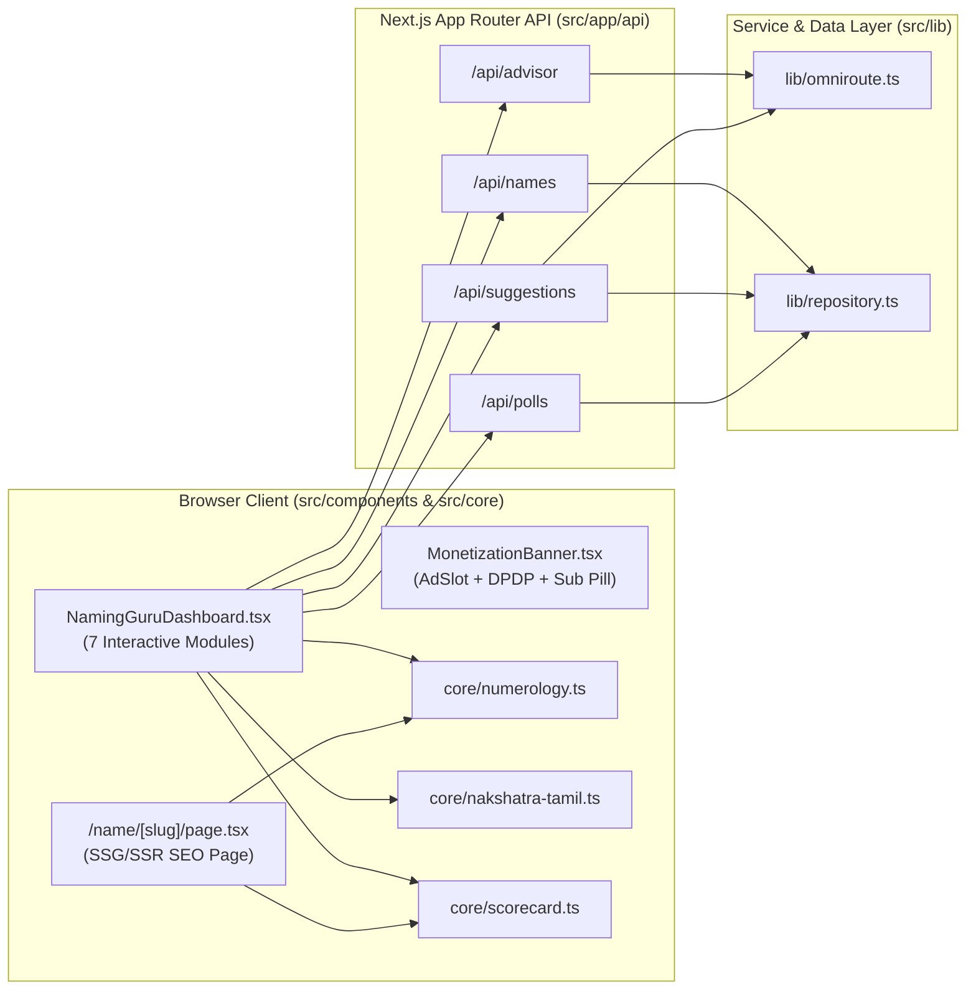

# Web MVP System Design (`app/`)

**Version:** 1.0 | **Date:** 2026-11-09 | **Stack:** Next.js 15 (App Router, TypeScript) + Tailwind CSS + OmniRoute AI + PostgreSQL/JSON Hybrid

---

## 1. Component Architecture

---

## 2. Database Schema Design (`src/data/schema.sql`)

Designed for a dedicated free **Supabase / Neon PostgreSQL** instance with `pg_trgm` fuzzy search indexing:

- **`tamil_names`**: Stores canonical Tamil script (`name_tamil`), Latin spelling (`name_latin`), gender, Tamil & English meanings, origin category, JSONB array of matching `nakshatra_slugs`, starting Tamil/Latin syllables, Rasi, literary reference, source citation, AI confidence score (`0.00–1.00`), and verification status.
- **`social_polls`**: Stores shareable poll token, parent name, title, JSONB array of candidate slugs, expiry timestamp, and JSONB array of relative votes (`voterName`, `lovedSlugs`, `removedSlugs`, `comment`).
- **`public_suggestions`**: Stores community-submitted Tamil names, OmniRoute AI moderation decision (`AI-Approved`, `Needs-Review`, `Rejected`), AI confidence score, AI review note, and model provenance (`ai_model_used`).
- **`error_reports`**: Stores user-submitted corrections against any name slug to mitigate AI curation risks.

---

## 3. Deterministic Core Algorithms

1. **Tamil Akshara Counter (`countTamilAksharas`)**:
   - Counts true Tamil orthographic syllables (grapheme clusters) by grouping dependent vowel signs (`ா`, `ி`, `ீ`, `ு`, `ூ`, `ெ`, `ே`, `ை`, `ொ`, `ோ`, `ௌ`) and pulli (`்`) with their base consonant (`உயிர்மெய்` / `மெய்`).
2. **Sidereal Moon & Natchathiram (`calculateBirthStarFromDateTime`)**:
   - Computes Julian Day ($JD$) and Julian Centuries ($T$) from IST birth date/time, evaluates Meeus periodic lunar longitude perturbations, subtracts **Lahiri (Chitrapaksha) Ayanamsa**, and maps sidereal longitude into `1..27` *Natchathiram* ($13^\circ 20'$ each) and `1..4` *Padam* ($3^\circ 20'$ each).
3. **Chaldean & Pythagorean Numerology (`calculateNumerology`)**:
   - Supports both English and direct Tamil script input (via automatic phonetic transliteration), computes Name Number (`1–9`), Compound Number (`10–52`), Soul Urge (vowels), Personality (consonants), and checks compatibility against Birth Day (*Mulank*) and Full DOB (*Bhagyank*).

