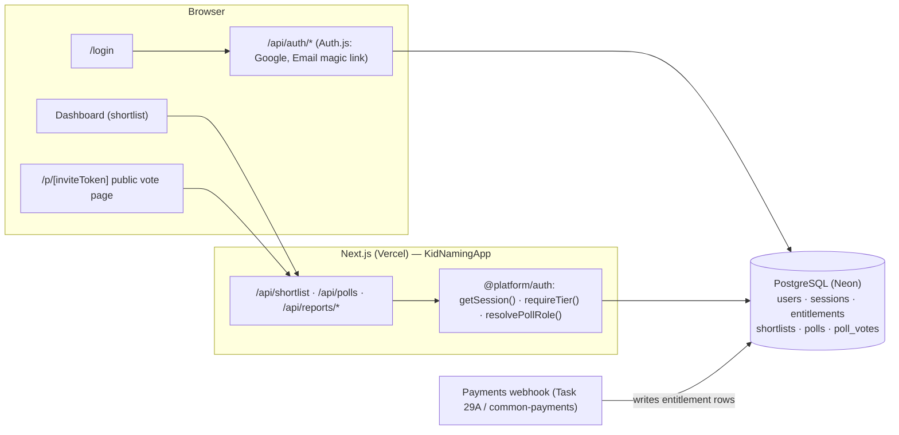

# Design 06 — Task 17: Login, Session Management, Entitlements & Secure WhatsApp Family Poll

**Status:** Proposed for adoption · **Author:** Claude (design) · **Implementer:** OmniRoute (see [10-OmniRoute-Directed-Implementation-Protocol.md](./10-OmniRoute-Directed-Implementation-Protocol.md))
**Reuses:** DonorConnect `JwtTokenProvider` / `UserEntity` patterns; common platform [`@platform/auth`](../../../common/code/frontend-ts/packages/auth) and spec [`COMMON-AUTH-02`](../../../common/doc/Plan/02-User-Authentication-And-Authorization.md) — see [07](./07-Task16-Common-Platform-Adoption-Design.md).
**Decisions already approved:** Task 17 Option A (PostgreSQL + Auth.js Google/Email magic link + server-side blind poll), 16B (PostgreSQL/Neon).

---

## 1. Why the current implementation is not secure (verified in code)

| # | Finding (file) | Impact | Severity |
| :-- | :-- | :-- | :-- |
| F1 | `GET /api/polls?viewer=creator` — role is a **client query param** (`api/polls/route.ts`) | Any relative can read every voter's choices and comments → "blind voting" is cosmetic | **Critical** |
| F2 | `POST /api/polls` gate uses `body.tier !== "kudumba_499"`, and only when `NEXT_PUBLIC_ENABLE_SUBSCRIPTION_PAYWALL=true` | ₹499 gate is bypassed by sending `tier` in the body, or by leaving the flag unset | **Critical** |
| F3 | `/api/reports/download-pdf` and `/family-booklet` read `?tier=` from the URL | ₹49/₹499 PDFs downloadable for free by editing the URL | **High** |
| F4 | Polls/shortlists persist to `runtime-store.json` (file) | Vercel FS is read-only/ephemeral → polls silently vanish in production | **High** |
| F5 | Shortlist lives only in `localStorage` | Lost on device change/logout — the original Task 17 requirement (I) is unmet | Medium |
| F6 | Poll link is `/?tab=poll&poll=<token>` (loads the full 150k-name dashboard) | Slow on mobile, no WhatsApp link preview | Medium |

> Task 17 and 17A statuses in TODO.md are re-opened to reflect F1–F3 (see TODO items **T17-1 … T17-9**).

## 2. Target architecture



**Principle:** the server derives *identity → tier → role* from a verified session and database rows. **No request field (`tier`, `viewer`, `role`, `isPaid`) is ever trusted.**

## 3. Session management

| Aspect | Decision | Why |
| :-- | :-- | :-- |
| Session type | **Opaque DB-backed session id** (cookie), not a stateless JWT | Revocable (logout / sign-out-everywhere), entitlement changes (e.g. just purchased ₹499) apply immediately, no JWT-secret rotation pitfalls. DonorConnect's stateless JWT remains valid for the Java stack; both share one claims/entitlement contract. |
| Cookie | `__Host-pc_session`; `HttpOnly; Secure; SameSite=Lax; Path=/` | `__Host-` prefix blocks subdomain overwrite; Lax allows the WhatsApp deep-link navigation. |
| Lifetime | Idle timeout 30 days sliding; absolute max 90 days | Parents return over a ~9-month pregnancy window; low friction. |
| Storage | `sessions(id_hash, user_id, expires_at, last_seen_at, user_agent_hash, ip_prefix)`; **only SHA-256 of the id is stored** | DB leak ≠ session hijack. |
| Logout | Delete row; "sign out everywhere" deletes all rows for `user_id` | |
| CSRF | Same-site cookie + `Origin` header check on all non-GET handlers + JSON-only content type | |
| Login methods | Phase 1: Google OAuth + Email magic link (15-min single-use token). Phase 2: Phone OTP (MSG91/Firebase), Facebook | Matches `COMMON-AUTH-02`; magic link needs no password; Google covers ~75% of users. |
| Bot/abuse | Magic-link: 5/hour/email, 20/hour/IP; constant-time token compare; no user-enumeration in responses | |

### 3.1 Login sequence

```mermaid
sequenceDiagram
  participant U as Parent
  participant L as /login
  participant A as Auth.js handler
  participant D as PostgreSQL
  U->>L: Choose Google or Email
  L->>A: signIn(provider, callbackUrl=/account or /?tab=poll)
  A->>D: upsert users, user_accounts
  A->>D: insert sessions(id_hash, user_id, expires_at)
  A-->>U: Set-Cookie __Host-pc_session; 302 callbackUrl
  U->>D: (every request) getSession(): hash cookie → join user + active entitlement
```

## 4. Data model (PostgreSQL; migration `V1__kidnaming_auth_poll.sql`)

```sql
-- users / user_accounts follow COMMON-AUTH-02 verbatim (shared with common-auth Java).
CREATE TABLE sessions (
  id_hash      CHAR(64) PRIMARY KEY,
  user_id      UUID NOT NULL REFERENCES users(id) ON DELETE CASCADE,
  expires_at   TIMESTAMPTZ NOT NULL,
  last_seen_at TIMESTAMPTZ NOT NULL DEFAULT now(),
  created_at   TIMESTAMPTZ NOT NULL DEFAULT now()
);
CREATE INDEX idx_sessions_user ON sessions(user_id);

CREATE TABLE entitlements (               -- written ONLY by payments webhook / admin grant
  id           UUID PRIMARY KEY DEFAULT gen_random_uuid(),
  user_id      UUID NOT NULL REFERENCES users(id) ON DELETE CASCADE,
  app_id       TEXT NOT NULL DEFAULT 'peyarcholai',
  tier         TEXT NOT NULL CHECK (tier IN ('suvadi_49','kudumba_499')),
  starts_at    TIMESTAMPTZ NOT NULL,
  expires_at   TIMESTAMPTZ NOT NULL,
  source       TEXT NOT NULL,             -- 'razorpay:<payment_id>' | 'admin:<email>'
  CHECK (expires_at > starts_at)
);
CREATE INDEX idx_ent_user_active ON entitlements(user_id, expires_at);

CREATE TABLE shortlists (
  user_id  UUID NOT NULL REFERENCES users(id) ON DELETE CASCADE,
  slug     TEXT NOT NULL,
  added_at TIMESTAMPTZ NOT NULL DEFAULT now(),
  PRIMARY KEY (user_id, slug)
);

CREATE TABLE polls (
  id            UUID PRIMARY KEY DEFAULT gen_random_uuid(),
  owner_user_id UUID NOT NULL REFERENCES users(id) ON DELETE CASCADE,
  invite_token  CHAR(26) UNIQUE NOT NULL,         -- 128-bit random, base32; the only secret in the URL
  title         VARCHAR(120) NOT NULL,
  notes         VARCHAR(500),
  candidate_slugs JSONB NOT NULL CHECK (jsonb_array_length(candidate_slugs) BETWEEN 1 AND 10),
  created_at    TIMESTAMPTZ NOT NULL DEFAULT now(),
  closes_at     TIMESTAMPTZ NOT NULL,             -- created_at + 30 days
  closed_at     TIMESTAMPTZ
);

CREATE TABLE poll_votes (
  id               UUID PRIMARY KEY DEFAULT gen_random_uuid(),
  poll_id          UUID NOT NULL REFERENCES polls(id) ON DELETE CASCADE,
  voter_token_hash CHAR(64) NOT NULL,             -- SHA-256 of per-voter cookie; lets a voter edit only their own vote
  voter_name       VARCHAR(60) NOT NULL,
  loved_slugs      JSONB NOT NULL DEFAULT '[]',
  removed_slugs    JSONB NOT NULL DEFAULT '[]',
  comment          VARCHAR(280),
  created_at       TIMESTAMPTZ NOT NULL DEFAULT now(),
  updated_at       TIMESTAMPTZ NOT NULL DEFAULT now(),
  UNIQUE (poll_id, voter_token_hash)
);
```

## 5. Role & entitlement resolution (the security core)

```ts
// @platform/auth — pure, unit-testable, no I/O
type PollRole = 'owner' | 'participant' | 'anonymous';
resolvePollRole(session: Session | null, poll: {ownerUserId: string}): PollRole
//   owner        ⇔ session?.userId === poll.ownerUserId
//   participant  ⇔ everyone else holding a valid invite token
activeTier(entitlements: Entitlement[], now: Date): 'free'|'suvadi_49'|'kudumba_499'
//   highest non-expired tier; expired ⇒ 'free'
requireTier(session, 'kudumba_499'): throws UpgradeRequired(403) | Unauthenticated(401)
```

### 5.1 Endpoint contract

| Endpoint | Auth | Behaviour |
| :-- | :-- | :-- |
| `POST /api/polls` | session + `requireTier('kudumba_499')` | Creates poll for `session.userId`; 1–10 unique slugs that exist in catalog; returns `{ pollId, inviteUrl }`. Body `tier`/`viewer` ignored. |
| `GET /api/polls/[inviteToken]` | none (token) | `owner` ⇒ full tally + all votes. `participant` ⇒ title, candidates, **own vote only**, aggregate `totalVotes` count. Never returns other voters' names/choices/comments. |
| `GET /api/polls/mine` | session | Owner's polls list. |
| `POST /api/polls/[inviteToken]/vote` | none + voter cookie `pc_voter` (set on first vote) | Upsert on `(poll_id, voter_token_hash)`; rejects closed/expired poll; max 50 voters/poll; rate-limit 10 votes/min/IP. |
| `POST /api/polls/[id]/close` | session owner | Sets `closed_at`. |
| `GET/PUT /api/shortlist` | session | Server-side shortlist (max 100). On first login, client merges its `localStorage` list (union, capped). |
| `GET /api/reports/*` | session + `activeTier` | `free` ⇒ watermarked; `suvadi_49`/`kudumba_499` ⇒ per entitlement table. **`?tier=` removed.** |
| `GET /api/me` | session | `{ user, tier, expiresAt, features }`. |
| `DELETE /api/me` | session | DPDP erase (Task 29B): cascades; polls owned are deleted. |

## 6. WhatsApp flow (effectiveness)

1. Owner clicks **Share on WhatsApp** → `https://wa.me/?text=` + URL-encoded message containing title, shortlisted names (Tamil + Roman), and `https://peyar.donorconnect.in/p/<inviteToken>`. On mobile use the Web Share API first (`navigator.share`), `wa.me` as fallback.
2. `/p/[inviteToken]` is a **lightweight SSR page** (no 150k catalog): server-rendered `<title>` + Open Graph tags (`og:title` = poll title, `og:description` = "Vote on N Tamil baby names"), so WhatsApp renders a rich preview; vote UI is mobile-first (≥44px targets, no login).
3. First vote sets the `pc_voter` cookie (random 128-bit, `HttpOnly; SameSite=Lax`, 60-day) so a relative can revise their own vote but never see others'.
4. Owner dashboard shows live tally (poll every 15 s while the tab is visible), "vote count", close button, and "share again" reminder.
5. WhatsApp Business API is **not** required (cost, templates, approval); revisit only if reminders/automation are needed.

## 7. Privacy, abuse & compliance

- Voter names/comments are personal data (DPDP 2023): consent line on the vote page; poll + votes hard-deleted 30 days after `closes_at`; owner can delete anytime; `/privacy` lists purpose & retention (Task 29A/29B).
- Output encoding for names/comments (React escapes by default; PDF/HTML routes must `escapeHtml`).
- Candidate slugs validated against the catalog server-side (no arbitrary strings stored).
- Logging: never log session ids, magic-link tokens, or invite tokens (redact to first 4 chars).
- Fail closed: if `DATABASE_URL` is missing in `NODE_ENV=production`, poll/shortlist/entitlement endpoints return 503 (never silently fall back to file storage). File store remains for local dev only.

## 8. Test strategy (strict acceptance — OmniRoute must satisfy these without edits)

| ID | Layer | Assertion |
| :-- | :-- | :-- |
| AC-17-01 | unit | `resolvePollRole(null, poll)` ≠ `'owner'`; session of another user ≠ `'owner'`; owner session ⇒ `'owner'`. |
| AC-17-02 | unit | `GET` view for participant contains **zero** votes belonging to other voter tokens; contains caller's own vote when `voterTokenHash` matches. |
| AC-17-03 | unit | `activeTier`: expired ⇒ free; two active ⇒ highest; boundary `expires_at === now` ⇒ expired. |
| AC-17-04 | unit | `requireTier` throws 401 for no session, 403 `UPGRADE_REQUIRED` for lower tier. |
| AC-17-05 | integration | Request with `?viewer=creator` and body `tier=kudumba_499` **still** yields participant view / 403. |
| AC-17-06 | integration | 11th candidate rejected (400); unknown slug rejected; closed poll vote rejected (409). |
| AC-17-07 | integration | Session cookie: set flags verified; logout invalidates immediately. |
| AC-17-08 | e2e (browser) | 375px viewport: `/p/<token>` loads < 1.5 s on local prod build, no horizontal scroll, vote submits. |
| AC-17-09 | security | Token entropy ≥ 128 bits; session id stored only as hash; no secrets in logs (grep test). |

## 9. Rollout

`T17-1` pure auth core → `T17-2` DB schema + repo → `T17-3` Auth.js + `/login` + `/account` → `T17-4` secure polls API + `/p/[token]` → `T17-5` server-side report gating → `T17-6` shortlist sync → `T17-7` DPDP delete/export → `T17-8` e2e + Six-Sigma sign-off. Each is an OmniRoute work item with the acceptance IDs above (see TODO.md).

**Open inputs needed from the product owner:** Google OAuth client ID/secret; SMTP/Resend key for magic links; Neon `DATABASE_URL`. Until supplied, work items T17-1/T17-2/T17-4 proceed against an in-memory repository interface (same contract), so nothing blocks.
