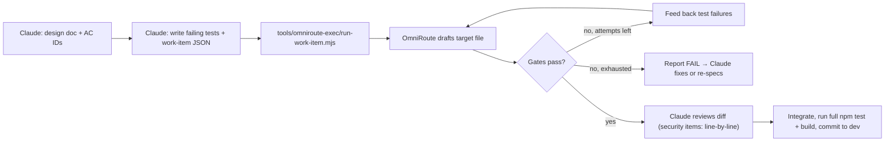

# Design 10 — OmniRoute-Directed Implementation Protocol

**Roles:** **Claude** designs, writes the acceptance tests, reviews and integrates. **OmniRoute** (`llama-cpp/qwen2.5-coder-14b` on the HP Z4, via `http://127.0.0.1:20128/v1`, `$0` cost) writes the implementation to satisfy those tests.
**Why this split:** a local 14B model is productive when the task is small, self-contained and *machine-checkable*; it is unreliable at open-ended design or large cross-file edits. So Claude removes ambiguity up front and the tests — not human judgement — decide pass/fail.

## 1. Work-item contract (every OmniRoute task must have all of these)

| Field | Rule |
| :-- | :-- |
| One target file | OmniRoute writes exactly **one** file per item (new file preferred). Cross-file wiring is a separate, Claude-reviewed integration item. |
| Tests first | Acceptance tests are written by Claude **before** the model runs and are read-only to the runner (SHA-256 checked before/after). |
| Exact API | Signatures, return types, error classes and edge cases are spelled out in the spec (no "implement sensibly"). |
| Closed dependency list | Spec lists allowed imports; anything else fails review. |
| Gates | All must pass: item's tests · `tsc --noEmit` (where applicable) · no changed test file · target path inside allow-list. |
| Retry budget | `maxAttempts` (default 4); each retry receives the failing output + the previous code. |
| Output | Attempt logs in `reports/omniroute/<item-id>/` (prompt, raw reply, extracted code, test output). |

## 2. Flow



## 3. Review policy

- **Security-sensitive items (auth, tokens, entitlement, poll access)**: Claude reads every line of the generated file before integration, regardless of green tests; extra adversarial tests are added if anything looks under-specified.
- **Everything else**: diff review + full suite.
- A green run is *evidence*, not proof: the item is "Done" only after the full `npm test`, `npm run build`, and Six-Sigma sign-off for the iteration.

## 4. Running

```powershell
# OmniRoute must be up:  see LLMDeployments/SetupNotes/DellG3-Notes/dailySetup.md
node tools/omniroute-exec/run-work-item.mjs tools/omniroute-exec/work-items/T16-1-auth-access.json
```
Environment: `OMNIROUTE_BASE_URL` (default `http://127.0.0.1:20128/v1`), `OMNIROUTE_API_KEY` (optional), `OMNIROUTE_MODEL` (default `llama-cpp/qwen2.5-coder-14b`; use `llama-cpp/qwen2.5-coder-7b` for speed or a cloud model such as `groq/llama-3.3-70b-versatile` for harder items).

## 5. Iteration plan (picked up from TODO.md, in dependency order)

| Iteration | Items | Needs from owner |
| :-- | :-- | :-- |
| **I-1 (now)** | T16-1 auth access primitives (common) · T17-0 interim poll-secret hardening · T20-1 remove hash noise + bands | none |
| I-2 | T16-2 git init + local link · T17-1 `@platform/auth` consumed by polls/report routes · T21-1/T22-1/T22-2 | none |
| I-3 | T17-2…T17-4 schema/Auth.js/login/`/p/[token]` · T20-2/T20-3 | Neon `DATABASE_URL`, Google OAuth, SMTP key |
| I-4 | T17-5…T17-8 · T20-4/5 · T21-2/3 · T22-3/5 | — |
| Human gates | T22-4 jyotishi sign-off · T29A–C legal inputs | Product owner |
