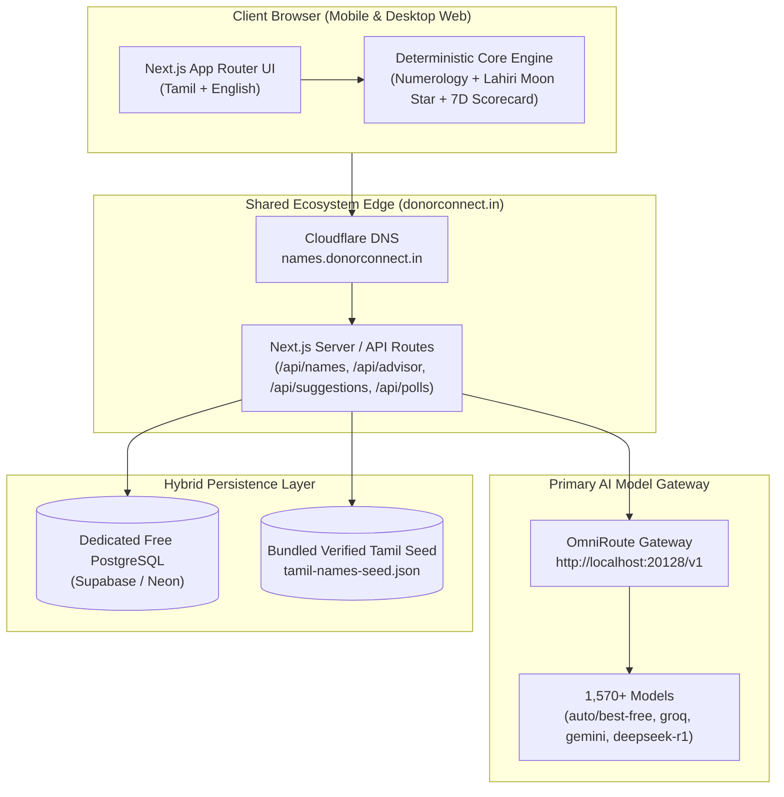

# 13 – Web MVP Implementation & Technical Design Document

**Version:** 1.0 | **Date:** 2026-11-09 | **Scope:** Tamil-First Web MVP (`app/`) | **AI Gateway:** OmniRoute (`http://localhost:20128/v1`)

---

## 1. Executive Summary & Alignment with Product Owner Decisions

This document captures the technical design and implementation of the **NamingGuru Tamil Web MVP** built in [`app/`](../../app) following the product owner's strategic decisions recorded in [doc 00](../00-Feasibility-Study-Master.md) and [doc 12 §4.1](12-Input-Reconciliation.md):

| Product Owner Decision | Implemented Technical Solution |
| :--- | :--- |
| **Q1. Language Scope:** Tamil only for MVP | Bilingual Tamil + English UI (`Noto Sans Tamil` + `Inter`), 27 Tamil *Natchathirams* (அசுவினி to ரேவதி), 12 *Rasis* (மேஷம் to மீனம்), 108 *Padam* starting syllables, Unicode Tamil Akshara grapheme counter, and Sangam/Literary Tamil name corpus. |
| **Q2. Budget & Infra:** Lean zero-cost infra alongside `donorconnect.in` + AI models | Full-stack **Next.js 15 (App Router, TypeScript)** deployable on Vercel mapped to `names.donorconnect.in` (Cloudflare DNS) backed by a dedicated free **Supabase / Neon PostgreSQL** database (`src/data/schema.sql`) with an automatic **Static JSON Seed + Local Store** fallback (`src/lib/repository.ts`). |
| **Q3. Monetization:** Ads from day one; subscription paywall after subscriber growth | Reusable `<AdBanner />` slots on directory and SEO detail pages, `<DpdpConsentBanner />` for DPDP Act 2023 compliance, and feature-flagged `<SubscriptionStatusPill />` (`NEXT_PUBLIC_ENABLE_SUBSCRIPTION_PAYWALL=false`). |
| **Q4. Curation:** AI generates/reviews meanings now; public suggestions AI-reviewed later | Build-time enrichment pipeline (`scripts/enrich-tamil-names.mjs`) + live runtime AI suggestion moderator (`/api/suggestions`) and AI Name Advisor (`/api/advisor`) powered by **OmniRoute** (`http://localhost:20128/v1`), plus confidence badges and a user "Report Error" flow. |

---

## 2. System Architecture (Implemented Web MVP)

---

## 3. Core Modules & File Map

| Module / Path | Responsibility |
| :--- | :--- |
| [`app/src/core/numerology.ts`](../../app/src/core/numerology.ts) | Deterministic **Chaldean** and **Pythagorean** calculators, Tamil-to-Latin phonetic transliterator, Mulank (Birth Number) & Bhagyank (Destiny Number), 9×9 planetary compatibility matrix, compound number (10–52) meanings, and phonetic spelling-variant generator. |
| [`app/src/core/nakshatra-tamil.ts`](../../app/src/core/nakshatra-tamil.ts) | All 27 Tamil *Natchathirams*, 12 *Rasis*, 4 *Padams* per star, auspicious Tamil & Latin starting syllables, plus offline **Meeus lunar ephemeris + Lahiri (Chitrapaksha) Ayanamsa** calculator. |
| [`app/src/core/scorecard.ts`](../../app/src/core/scorecard.ts) | **7-Dimension Name Evaluation Engine**: (1) Pronunciation ease, (2) Tamil Akshara & Latin character count, (3) Meaning & AI confidence, (4) Sangam/Literary reference, (5) Family/Sibling harmony, (6) Misspelling risk & variants, (7) Uniqueness band. |
| [`app/src/lib/omniroute.ts`](../../app/src/lib/omniroute.ts) | OpenAI-compatible client for the local **OmniRoute** gateway (`http://localhost:20128/v1`) with multi-model fallback (`auto/best-free` → `groq/llama-3.3-70b-versatile` → `gemini/gemini-2.5-flash`). |
| [`app/src/lib/repository.ts`](../../app/src/lib/repository.ts) | Hybrid data access layer for Tamil names, Social "Vote-Out" Polls, Public Name Suggestions, and Error Reports. |
| [`app/scripts/enrich-tamil-names.mjs`](../../app/scripts/enrich-tamil-names.mjs) | Build-time AI enrichment pipeline that queries OmniRoute in JSON mode and merges verified Tamil baby names into `src/data/tamil-names-seed.json`. |
| [`app/src/data/schema.sql`](../../app/src/data/schema.sql) | DDL schema (`tamil_names`, `social_polls`, `public_suggestions`, `error_reports`) with `pg_trgm` indexes for Supabase / Neon PostgreSQL. |
| [`app/src/components/NamingGuruDashboard.tsx`](../../app/src/components/NamingGuruDashboard.tsx) | Interactive 7-tab Tamil-first Web Application (Explorer, Birth Star Finder, Numerology, 7D Scorecard, OmniRoute AI Advisor, Family Vote-Out Poll, and Public Suggestion Queue). |
| [`app/src/app/name/[slug]/page.tsx`](../../app/src/app/name/[slug]/page.tsx) | Static/SSR SEO detail page for every Tamil baby name with full numerology, 7D scorecard, literary citation, and ad slot. |

---

## 4. API Reference (Next.js App Router)

| Endpoint | Method | Description |
| :--- | :--- | :--- |
| `/api/names` | `GET` | Filter Tamil names by `q`, `gender`, `nakshatra`, `numerology` (1–9), `origin`, and `startingLetter`. |
| `/api/names` | `POST` | Submit a meaning/citation correction report (`action: "report_error"`). |
| `/api/advisor` | `POST` | Live **OmniRoute AI Tamil Name Advisor** — generates tailored Sangam/traditional Tamil name recommendations with live Chaldean numerology scoring. |
| `/api/suggestions` | `GET / POST` | Public Tamil name suggestion submission; calls **OmniRoute AI** in real time to verify meaning & authenticity and auto-publishes `AI-Approved` entries. |
| `/api/polls` | `GET / POST` | Create a shareable Family "Vote-Out" Poll from a parent shortlist and record relative votes (`lovedSlugs`, `removedSlugs`, comments). |

