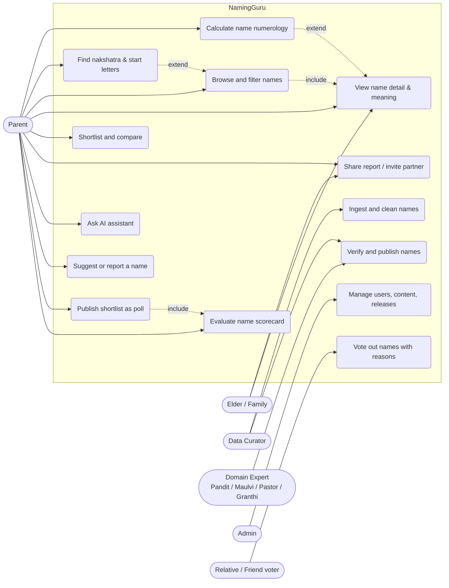
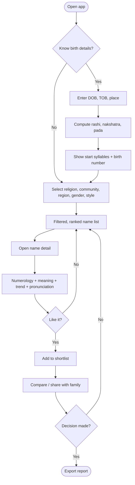

# 01 – Vision, Scope & Requirements

## 1. Vision

> One trusted place where any Indian family – regardless of religion, region, language or belief in astrology – can discover, evaluate and shortlist a name for their child, with explanations they can share with elders.

## 2. Personas

| Persona | Needs | Key features |
| :-- | :-- | :-- |
| **Traditional parents (Hindu)** | Name must start with nakshatra syllable, numerology-favourable, auspicious meaning | Birth-details → nakshatra/rashi → letters → names, numerology score |
| **Modern urban parents** | Short, unique, easy to pronounce globally, trending, no awkward nicknames | Trend, ease-of-call score, nickname preview, sibling-name harmony |
| **Muslim / Christian / Sikh / Jain / Parsi / Buddhist families** | Religiously authentic names with correct meaning/origin | Religion-specific pools; Sikh Hukamnama letter; Islamic name meaning/source |
| **Regional-language families** | Names in Tamil/Telugu/Kannada/Malayalam/Bengali/Marathi etc. with native script | Multi-script display and search, region/state filter |
| **Grandparents / elders** | Verify with horoscope, family tradition (kuladevata, ancestor names) | Shareable PDF report, vernacular UI, voice pronunciation |
| **Pandits / astrologers (secondary)** | Quick reference, credibility | Verified-by-expert badge, consultation referral |

## 3. Scope

### In scope (v1)
1. **Numerology calculator** – Chaldean, Pythagorean, and Indian (Cheiro/Loshu) systems; Name, Birth, Destiny, Soul-urge, Personality numbers; predictions; compatibility with DOB (see doc 03).
2. **Horoscope-aware naming** – birth date/time/place → Moon sign (rashi), nakshatra, pada → recommended starting syllables; optional basic Kundli matching with parents' names.
3. **Name directory** – large classified pool with 10+ filters.
4. **Shortlist, compare, share** – favourites, side-by-side compare, PDF/image report, WhatsApp share, partner collaboration.
5. **Name detail page** – meaning (multi-language), origin, scripts, pronunciation audio, famous bearers, numerology, popularity trend, nickname options.
6. **Mobile apps** (Android, iOS) and **web** (SEO-friendly). *Per the reconciliation ([doc 12](12-Input-Reconciliation.md)): web first; Android after traction evidence.*
7. **Evaluation scorecard** and **social “vote-out” poll** (FR-19, FR-20) – the main differentiators vs. static name lists and astrology portals.
8. **MVP content scope:** ~20k verified names, **3 languages** (default Hindi + Tamil + Telugu, owner to confirm – doc 12 Q1), Hindu/Muslim/Christian/Sikh pools first; other languages and faiths follow in v1.
7. **Admin / curator console** – ingest, dedupe, verify, publish names.

### Out of scope (v1)
Full paid astrology consultations marketplace, e-commerce, social network, birth-certificate/legal processes, adult names change flow (candidate for v3).

## 4. Functional requirements

| ID | Requirement | Priority |
| :-- | :-- | :-- |
| FR-01 | Compute numerology numbers for a name using selectable systems (Chaldean/Pythagorean) for Latin and transliterated Indic scripts | Must |
| FR-02 | Provide predictions text per number (personality, career, relationships, lucky colour/day/gem, caution) | Must |
| FR-03 | Match name number with birth number / destiny number and give compatibility rating with explanation | Must |
| FR-04 | Compute Moon rashi & nakshatra & pada from DOB, TOB, POB (offline-capable approx. + API for precision) | Must |
| FR-05 | Suggest starting syllables from nakshatra pada and filter names accordingly | Must |
| FR-06 | Search names by prefix, meaning keyword, transliteration-tolerant fuzzy match | Must |
| FR-07 | Filter by community, religion, region, state, language, gender, trend, easy-to-call score, meaning theme, starting letter, syllable count, numerology number | Must |
| FR-08 | Show name detail with native script(s), meaning, origin, source citation, pronunciation | Must |
| FR-09 | Shortlist/favourites, compare up to 4 names, share via link/WhatsApp/PDF | Must |
| FR-10 | Combine parent names/surname to evaluate full-name numerology and initials | Should |
| FR-11 | Sibling harmony and nickname generator/warnings (e.g. unfortunate nicknames, English meaning clashes) | Should |
| FR-12 | Multi-language UI (EN, HI, TA, TE, KN, ML, BN, MR, GU, PA, OR) | Should |
| FR-13 | User contribution: suggest names/meanings, report errors, upvote | Should |
| FR-14 | AI assistant (“describe what you want in your own words”) grounded in the name DB (RAG) | Could |
| FR-15 | Pronunciation audio (TTS pre-generated, human-recorded for top names) | Could |
| FR-16 | Premium reports, ad-free, consultation referral | Could |
| FR-17 | Admin console for ingest, dedupe, review queue, publish with audit trail | Must |
| FR-18 | Offline mode for numerology and shortlist; synced when online | Should |
| FR-19 | **Social poll “vote out a name”:** parent publishes a shortlist (≤ 10); invited relatives/friends open a private web link (no install), mark names to **remove** (and optionally ones they love) with a structured reason; parent sees aggregated counts and reasons and picks the final name. Private by default, auto-close after N days (default 7), profanity filter, parent can delete comments, voters never see each other’s comments | Must (MVP, differentiator) |
| FR-20 | **Evaluation scorecard** per name across 7 dimensions: pronunciation ease, character count (Latin + native aksharas + syllables), meaning, historical/scriptural reference, family match, misspelling risk, uniqueness band | Must (MVP: character count, misspelling, meaning; others phased) |
| FR-21 | Family match: sibling/parent/grandparent names → same-initial/rhyme/sound-clash warnings; tradition rules configurable, never forced | Should |
| FR-22 | References shown only with citation (text, chapter/verse or page, edition); otherwise “No verified reference found” | Must |
| FR-23 | Uniqueness percentile/band labelled **“estimate”** until trustworthy frequency data exists | Should |
| FR-24 | Initials/monogram check (unfortunate initials) | Could |
| FR-25 | Document-friendliness check (Aadhaar/passport length limits, transliteration consistency, recommended official spelling) | Could |
| FR-26 | Naming-ceremony (namakaran) planner: muhurat, checklist, invitation cards | Could (partnership revenue) |
| FR-27 | International/NRI usability: pronunciation and meaning abroad | Could |

## 5. Non-functional requirements

| ID | Category | Requirement | Measure |
| :-- | :-- | :-- | :-- |
| NFR-01 | Correctness | Numerology engine matches golden test set | 100% of 500 golden cases |
| NFR-02 | Data accuracy | Published name records fully verified (gender, religion, meaning, origin) | ≥ 99.5% accuracy on audit sample (≈ 4.1σ), path to 99.9% |
| NFR-03 | Performance | Search p95 latency | ≤ 300 ms server; ≤ 1.5 s end-to-end on 4G |
| NFR-04 | Availability | Monthly uptime | ≥ 99.5% (MVP), 99.9% (v2) |
| NFR-05 | Mobile | App size, cold start | ≤ 35 MB, ≤ 2.5 s on 3 GB RAM Android |
| NFR-06 | Reach | Works on Android 8+, iOS 15+, low-end devices, flaky networks | Offline numerology + cached shortlist |
| NFR-07 | Privacy | Birth data is personal data; DPDP Act 2023 compliance, consent, deletion | Delete within 30 days of request |
| NFR-08 | Security | OWASP ASVS L1/L2, encrypted at rest/in transit | No critical findings at release |
| NFR-09 | Accessibility | WCAG 2.1 AA, large-text, Indic font rendering | Audit pass |
| NFR-10 | Maintainability | Shared core library, ≥ 80% unit coverage on engine | CI gate |
| NFR-11 | SEO | Each name has a crawlable page with schema.org markup | Index coverage ≥ 90% |
| NFR-12 | Cost | MVP run cost | ≤ ₹3,500 / month |

## 6. Use-case diagram

## 7. Core user journey (activity)

## 8. Assumptions & constraints

* Numerology and nakshatra-based naming are **cultural / belief-based guidance**, not science; the app presents them with a clear disclaimer and lets users switch systems.
* Name “meaning” and “origin” must cite a source; unverifiable items are flagged *Unverified* and excluded from default results.
* Team: 1 full-stack lead + 1 mobile/frontend + part-time curator + AI agents; budget minimised using free tiers.

