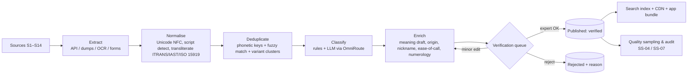

# 02 – Name Sourcing Strategy

**Goal:** a verified, classified pool of **20k (MVP) → 60k (v1) → 150k+ (v2)** names that serves every major Indian tradition, not only mainstream Hindu names.

## 1. Principles

1. **Names are facts; descriptions are creative works.** A name string is not copyrightable, but a site's curated list, ordering and meaning text is. We collect names from many sources and **write our own meaning text** (human-verified, AI-drafted).
2. **Every record carries provenance** (`source_id`, URL/citation, licence, retrieval date).
3. **No wholesale scraping** of commercial baby-name sites (ToS and copyright risk).
4. **Human verification** by a community/domain expert for religion-specific names (Gate G3 in SS-08).
5. **Tiered trust:** `verified` → `reviewed` → `candidate` → `rejected`. Only `verified`/`reviewed` appear by default.

## 2. Source options (all channels)

| # | Source channel | Examples | Covers | Licence / legal | Volume | Quality | Cost | Verdict |
| :-- | :-- | :-- | :-- | :-- | :-- | :-- | :-- | :-- |
| S1 | **Open knowledge bases** | Wikidata given-name items, Wikipedia name-disambiguation pages, Wiktionary | Multi-language, gender, script | CC0 / CC-BY-SA (attribute) | 30–60k | Med (noisy) | Free | ✅ Core |
| S2 | **Public-domain scriptures & epics** | Ramayana, Mahabharata, Puranas, Vishnu/Shiva/Lalita Sahasranama, Upanishads, Bhagavad Gita | Hindu, classical Sanskrit, deity names | Public domain (use original text, not modern translations) | 5–8k | High meaning accuracy | Free | ✅ Core |
| S3 | **Sanskrit lexicons** | Monier-Williams, Apte, Amarakosha (via Cologne Digital Sanskrit Lexicon) | Meaning, etymology | Open-licensed (check per dictionary) | 10k+ roots | High | Free | ✅ Meaning enrichment |
| S4 | **Religious texts of other faiths** | Quranic names & Asma-ul-Husna, Hadith names, Bible (KJV/Public domain), Guru Granth Sahib, Jain Tirthankara/Agam, Pali canon, Avesta | Muslim, Christian, Sikh, Jain, Buddhist, Parsi | Public domain / open | 6–10k | High | Free | ✅ Core |
| S5 | **Regional classical literature** | Tamil Sangam (Tolkappiyam, Thirukkural), Kannada vachanas, Telugu Prabandhas, Malayalam classics, Bengali (Tagore), Marathi saints | Regional/native names | Mostly public domain | 5–10k | High | Free | ✅ v1 |
| S6 | **Open datasets** | Kaggle “Indian names” sets, GitHub name lists, NLTK `names`, HuggingFace name corpora | Broad, mixed | **Mixed – check each**; many “Other/unspecified”. Use as *candidate names only*, not meanings | 30–60k | Low–Med | Free | ⚠️ Candidates only |
| S7 | **Government / institutional** | Electoral rolls, school admissions, census surname lists, university lists, Kerala/TN public-service lists | Real-world frequency, regional distribution | Often restricted; use only openly published aggregates (data.gov.in – NDSAP) | Varies | High for popularity | Free | ⚠️ Aggregates only, DPDP-safe |
| S8 | **Community & expert contributors** | Pandits, maulvis, pastors, granthis, Jain munis, regional language scholars, retired teachers | Authentic, hyper-local | Contributor agreement (CC-BY / assignment) | 10–30k | **Highest** | Honorarium ₹30–60k | ✅ Core for trust |
| S9 | **Crowdsourcing (UGC)** | “Suggest a name”, “Report error”, upvotes | Emerging/regional names | ToS grant + moderation | grows | Low→Med after review | Free + moderation | ✅ v1 |
| S10 | **AI-generated candidates** (via OmniRoute) | LLM proposes names per community/region/theme + drafts meanings | Fills gaps in coverage | Output is ours; must be verified | 20–50k | **Hallucination risk** | ~Free via OmniRoute | ✅ Draft only, never auto-publish |
| S11 | **Trend signals** | Google Trends, celebrity/film/OTT/cricketer names, Instagram/Reels trending baby names, in-app search & favourite analytics | Trend score | Aggregates / own analytics | n/a | Med | Free | ✅ Trend dimension |
| S12 | **Licensed data partnerships** | Baby-name publishers, astrologer networks, panchang providers | Curated meanings, rashi mapping | Commercial licence | 50k+ | High | ₹₹ (negotiated) | 🔶 Option if scaling |
| S13 | **Print & book digitisation** | Public-library name dictionaries (out-of-copyright), Gazetteers | Archaic/regional names | Public domain only after 60 yrs of author's death | 5k | Med (OCR) | OCR cost | 🔶 Optional |
| S14 | **Phonetic/rule generators** | Syllable-based generator following language morphology (e.g., Sanskrit sandhi, Tamil naming) | Unique modern-sounding names | Own IP | unbounded | Needs review | Low | 🔶 v2 “Create unique name” |

## 3. Coverage matrix – ensuring all Indian audiences are served

| Dimension | Values (initial taxonomy) | Primary sources |
| :-- | :-- | :-- |
| Religion | Hindu, Muslim, Christian, Sikh, Jain, Buddhist, Parsi/Zoroastrian, Jewish (Bene Israel), Tribal/Sarna, Non-religious/Secular | S2,S4,S8 |
| Language | Hindi, Sanskrit, Tamil, Telugu, Kannada, Malayalam, Bengali, Marathi, Gujarati, Punjabi, Odia, Assamese, Urdu, Konkani, Kashmiri, Sindhi, Nepali, Manipuri, Tulu, Bhojpuri | S1,S5,S8 |
| Community / sub-group | Brahmin (Iyer, Iyengar, Deshastha…), Rajput, Maratha, Nair, Reddy, Vokkaliga, Lingayat, Bengali Kayastha, Marwari, Sindhi, Syed/Pathan/Sheikh, Syrian Christian, Anglo-Indian, Khalsa, Agarwal Jain, Tribal communities… | S8 (expert-tagged) |
| Region / State | 28 states + 8 UTs; zone (N/S/E/W/NE/Central) | S1,S5,S7,S8 |
| Gender | Boy, Girl, Unisex | all |
| Theme (meaning) | Deities, nature, virtues, rivers/mountains, stars, music, warrior, wisdom, light, flowers, birth-season… | S2,S3,S10 |
| Trend | Classic, Evergreen, Rising, Modern, Rare/Unique | S11 |
| Ease of call | 1–5 score (see doc 04 §4) | computed |
| Starting letter | Latin + native script | computed |
| Nakshatra syllable | 108 syllable map | computed (doc 03) |

> Sub-community tagging is **expert-verified only** and optional on a record. Never infer caste from a name algorithmically (ethical rule, see doc 11).

## 4. Pipeline – from source to published name

### Verification workflow (Gate G3)
1. AI drafts religion, language, gender, meaning, origin with **confidence score** and cites the lexicon/scripture line.
2. Auto-accept only if: ≥ 2 independent sources agree **and** confidence ≥ 0.9 **and** not religion-sensitive.
3. Religion/community-sensitive or low-confidence → expert queue (target throughput 150 names/expert-hour).
4. 5% random sample audited every release (acceptance sampling, SS-07).

## 5. Phased acquisition plan

| Phase | Target | Sources used | Effort |
| :-- | :-- | :-- | :-- |
| P0 (wk 1–4) | 20k names, 6 religions, 8 languages | S1,S2,S4, S6 (candidates), S10 | 2 weeks pipeline + 2 weeks verification |
| P1 (wk 5–12) | +20k, regional depth, trend | S5, S8, S11 | Recruit 8–12 expert advisors |
| P2 (v1.x) | 60k | S9 UGC, S3 meaning enrichment | Moderation workflow |
| P3 (v2) | 150k+ | S12 partnerships, S14 generator | Commercial deals |

## 6. Quality & cost expectations

| Item | Estimate |
| :-- | :-- |
| Expert verification | ≈ ₹3–5 / name → 20k names ≈ ₹60k–1L |
| Advisor honoraria (12 experts) | ≈ ₹30–60k for MVP |
| AI drafting cost (OmniRoute free tiers) | ≈ ₹0 (≈ 40M tokens for 60k names; well within free pools) |
| OCR / digitisation (optional) | ≈ ₹10–30k |

## 8. Refinements from the earlier study (doc 12)

**What does “1 crore names” mean?** 10 million *records* is plausible; 10 million *distinct curated names* is not. Distinct given names are likely hundreds of thousands to low millions including spelling variants. Define the target as **distinct canonical names + variants/transliterations + aggregate frequency counts**, and treat “1 crore” as total variants/occurrences. This plan’s 20k → 60k → 150k+ figures are *distinct canonical names*.

| Source | Verdict (from input `doc/02`) | Effect on this plan |
| :-- | :-- | :-- |
| Census | Not a name source (no individual names) | Do not list |
| Electoral rolls | High risk (personal data; DPDP) – avoid, aggregate counts only after legal advice | S7 restricted to openly published aggregates |
| Birth registries | Not available in bulk | Do not list |
| Social-media public names | Avoid (platform terms, personal data) | Excluded; S11 uses aggregate trend signals only |
| Baby-name websites | Licence/partner rather than scrape | Matches principle 3 |
| Hospitals, schools, language authorities, universities, NGOs | Pursue for **anonymised aggregate frequency** data | New source **S15 – aggregate-frequency partnerships**; feeds the uniqueness score (FR-23) |
| LLM variants/transliterations | Use for variants, not facts; flag unverified | Matches S10 |

**Data model additions:** per name `frequency` (aggregate, per region), `references[]` (text + citation), `license`, `last_reviewed` – see doc 04 §7.

Uniqueness score stays labelled **estimate** until S15 data exists.

## 7. Decision

Adopt **S1+S2+S3+S4+S5 as the licensed-clean backbone**, **S8** for trust and community depth, **S6/S10 as candidate generators only**, **S9/S11** for freshness. Avoid scraping commercial sites. Reassess **S12** after 10k MAU.

