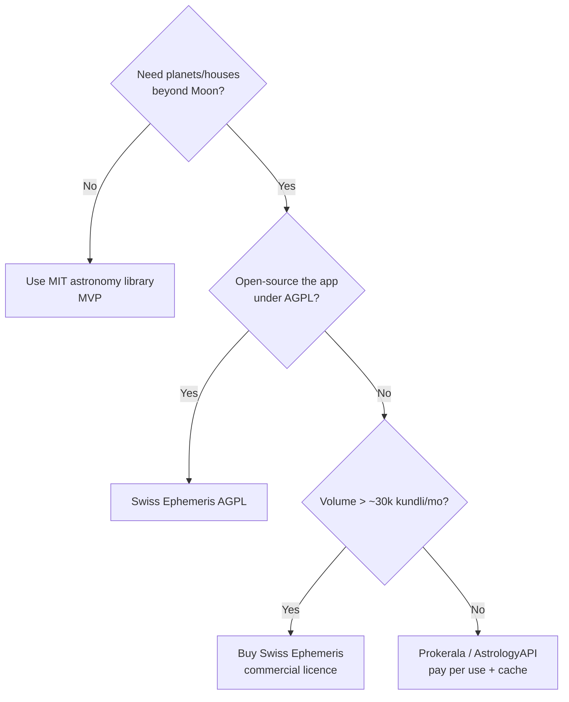

# 06 – Technical Feasibility Study

**Scale:** 🟢 feasible / low risk · 🟡 feasible with mitigation · 🔴 high risk

## 1. Feasibility summary

| # | Area | Verdict | Key finding |
| :-- | :-- | :-- | :-- |
| 1 | Numerology calculator | 🟢 | Deterministic arithmetic; runs offline; effort ≈ 2 weeks incl. golden tests |
| 2 | Nakshatra/rashi from birth data | 🟢 | Only Moon longitude needed; MIT-licensed astronomy library + Lahiri ayanamsa is enough |
| 3 | Full Kundli / matching (36 gunas) | 🟡 | Needs planet positions → Swiss Ephemeris (AGPL / paid licence) or managed API |
| 4 | Predictions content | 🟡 | Content authoring + expert review is the real effort, not code |
| 5 | Name pool 20k→150k | 🟡 | Achievable from open sources + experts; accuracy and licensing are the risks |
| 6 | Multi-attribute classification | 🟡 | Rule+LLM classification feasible; sub-community tagging must be expert-led |
| 7 | Search (fuzzy, multi-script) | 🟢 | PostgreSQL trigram + phonetic key adequate to 150k records |
| 8 | Mobile apps (Android+iOS) | 🟢 | Expo RN; offline SQLite; OTA updates |
| 9 | Web (SEO) | 🟢 | Next.js static generation of name pages |
| 10 | AI enrichment via OmniRoute | 🟡 | Excellent for batch/offline; free-tier ToS and reliability limit use in user-facing realtime paths |
| 11 | Pronunciation audio | 🟡 | TTS quality for Indic names is uneven; human recordings for top 2k names |
| 12 | Deployment & ops | 🟢 | Scale-to-zero serverless in Mumbai; < ₹3.5k/mo MVP |
| 13 | Legal / privacy | 🟡 | DPDP Act consent, birth-data minimisation, content licences |
| 14 | Monetisation | 🟡 | Freemium reports, ads, partner referrals; low ARPU in India; break-even hinges on 2–3% paid conversion and SEO/poll virality (doc 08 §5) |
| 15 | Social “vote-out” poll | 🟢 | Standard CRUD + token links + aggregation; main risks are abuse, family conflict and privacy (doc 11 §6, SS-05 F-21) |
| 16 | Scorecard: char count, misspelling, family-initial checks | 🟢 | Deterministic; akshara (grapheme-cluster) counting needed for Indic scripts |
| 17 | Scorecard: uniqueness | 🔴→🟡 | No trustworthy frequency data exists openly; label as estimate; needs partnerships (S15) |
| 18 | Scorecard: references | 🟡 | Curated by scholars only; budget required |

**Overall: GO – conditional** on (a) market validation gate G0 (waitlist, interviews, price test), (b) licence strategy for ephemeris, (c) expert verification pipeline, (d) legal review of data sources. This matches the “conditional go” of the earlier study.

## 2. End-to-end implementation view

## 3. Detailed assessments

### 3.1 Numerology & horoscope
* **Spec complete** (doc 03). Risks: variant traditions disagree → mapping is configurable data; expert-reviewed default.
* **Time-zone correctness:** birth data historically in IST/local mean time varies. Use IANA tzdata; for India pre-1947 offer a manual UTC-offset override.
* **Ephemeris licence decision tree**

### 3.2 Name data feasibility
* **Coverage test:** A proof-of-concept (2 weeks) will ingest S1+S2+S4+S6 and measure: unique names, % with gender, % with religion tag, % with a cited meaning. Go/no-go threshold: ≥ 20k unique names with ≥ 70% meaningful metadata before expert review.
* **Hallucination risk** for AI-drafted meanings (esp. rare regional names) → verified-only publishing; confidence thresholds; ≥ 2-source rule.
* **Throughput:** 60k names × ~700 tokens ≈ 42M tokens for first-pass enrichment; free pools listed in the OmniRoute reference cover > 1B tokens/month, so cost ≈ ₹0.

### 3.3 Mobile & web
| Topic | Assessment |
| :-- | :-- |
| Low-end Android | Expo with Hermes; 20–25 MB SQLite snapshot lazy-downloaded after install |
| Indic rendering | Bundle Noto fonts (subsetted) – avoids broken glyphs on old devices |
| App Store policy | Astrology/religious content allowed; avoid “guaranteed prediction” claims |
| Release speed | EAS Update (OTA) for JS changes; stores only for native changes |
| Web SEO | ISR pages `/names/<slug>`, hreflang for languages, schema.org `Thing`; sitemap sharding (50k URLs per file) |

### 3.4 AI usage feasibility (OmniRoute)
| Use | Realtime? | Feasible via free tiers? | Production strategy |
| :-- | :-- | :-- | :-- |
| Batch classification / drafting | No | ✅ | OmniRoute `auto/best-free`, reasoning model for hard cases |
| Translating meanings | No | ✅ | Batch, then human spot check |
| Ease-of-call & nickname screening | No | ✅ | Batch |
| In-app assistant (RAG) | Yes | 🟡 | Paid-capable fallback (e.g. Gemini Flash) behind OmniRoute, budget cap, cached answers |
| Dev assistance (code, docs) | – | ✅ | Multi-agent team via OmniRoute |

### 3.5 Scalability envelope
| Metric | MVP | v1 | v2 |
| :-- | :-- | :-- | :-- |
| MAU | 5k | 50k | 500k |
| Peak RPS (API) | 2 | 20 | 150 |
| DB size | < 500 MB | ~2 GB | ~8 GB |
| Name pages for SEO | 20k | 60k | 150k × languages |
| Snapshot download | 15 MB | 25 MB | 40 MB (per-language packs) |

Because browsing/numerology is offline-first, API load is dominated by detail enrichment, shortlist sync, and assistant calls → comfortably inside serverless free/low tiers early on.

## 4. Technology choice scoring (weighted)

| Criterion (weight) | Expo RN + Next.js (TS) | Flutter + Python | Native + Java |
| :-- | :-- | :-- | :-- |
| Shared engine code (25) | 5 | 2 | 1 |
| Time to MVP (20) | 5 | 4 | 2 |
| Cost (15) | 5 | 4 | 3 |
| Performance on low-end (15) | 3 | 4 | 5 |
| Hiring pool in India (10) | 5 | 3 | 4 |
| AI-agent friendliness (10) | 5 | 3 | 3 |
| SEO web (5) | 5 | 2 | 2 |
| **Weighted total (/5)** | **4.7** | **3.3** | **2.7** |

## 5. Proof-of-concept backlog (de-risking, 3 weeks)

| PoC | Question | Success criterion |
| :-- | :-- | :-- |
| PoC-1 | Does MIT library + Lahiri give correct nakshatra? | 200/200 nakshatra match vs panchang |
| PoC-2 | Can open sources yield 20k usable names? | ≥ 20k unique, ≥ 70% classified |
| PoC-3 | Can LLM draft meanings at ≥ 90% expert acceptance? | ≥ 90% on 300 sample |
| PoC-4 | SQLite snapshot size & search speed on a ₹8k phone | ≤ 25 MB, ≤ 200 ms |
| PoC-5 | OmniRoute fallback under rate limits | ≥ 99% batch completion with automatic fallback |

## 6. Top technical risks
See the full register in [SS-06](six-sigma/SS-06-Risk-Register.md) and FMEA in [SS-05](six-sigma/SS-05-FMEA.md).

