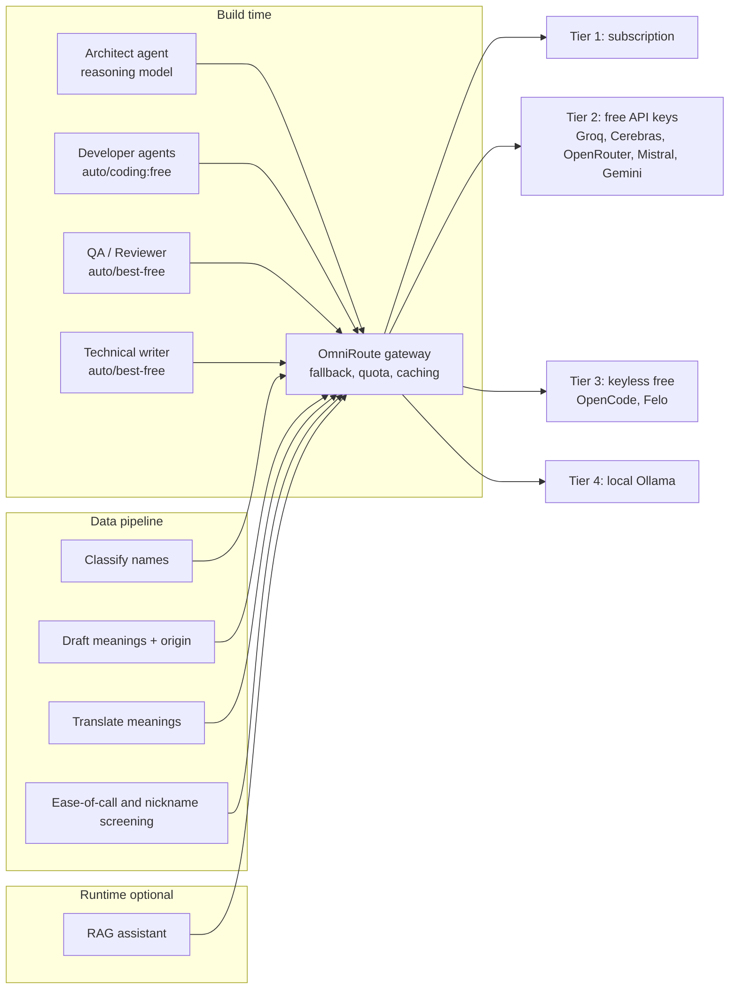

# 09 – OmniRoute AI Usage Plan

Reference material: `E:\project\donorconnect\doc-consolidated\Plan\AIToolUsage\OmniRoute\` (README, Multi-Agent guide, Throughput blueprint). OmniRoute v3.8.50 exposes an OpenAI-compatible gateway at `http://localhost:20128/v1` with automatic quota fallback across free and paid providers.

## 1. Where OmniRoute is used



## 2. Model routing policy

| Task | Model alias (from OmniRoute docs) | Why |
| :-- | :-- | :-- |
| Architecture, feasibility, risk analysis, FMEA (**high reasoning**) | `oc/deepseek-r1` (primary), `antigravity/claude-opus-4-6-thinking` or a Claude Sonnet class model (if Tier 1 quota available) | Deep multi-step reasoning |
| Code generation, tests | `auto/coding:free`, `groq/qwen-2.5-coder-32b` | Throughput |
| Review, docs, summarisation | `auto/best-free` | Balanced |
| Bulk name enrichment (JSON mode) | `groq/llama-3.3-70b-versatile` → `cerebras/llama3.3-70b` → `gemini/gemini-2.5-flash` | Speed + free quota |
| Hard/ambiguous names (low confidence) | escalate to `oc/deepseek-r1` | Reasoning |
| Long-context (large source files) | `gemini/gemini-2.5-flash` | 1M context |

Aliases must be re-validated against `GET /v1/models` at run time – catalogues change.

> **Lesson from the earlier study (`doc/06` §8):** a second opinion from `auto/coding:free` (served by gpt-oss-120b) produced a table that was “partly inconsistent and cut off”. Therefore **analysis and review tasks must use a reasoning-grade model (Claude thinking class or `oc/deepseek-r1`), not `auto/*:free` aliases**, with `max_tokens` high enough to avoid truncation and a human check of any numbers.

## 3. Multi-agent development team

Reuse the 7-role pattern in the OmniRoute reference (Architect → Developer → QA/Security → Remediator → Feature Validator → Technical Writer). Working agreement for NamingGuru:

| Role | Output location | Gate |
| :-- | :-- | :-- |
| Architect | `doc/` (ADR, diagrams) | G1 design review |
| Developer | `app/` | PR + unit tests |
| QA/Security | `app/tests/`, scan reports | G4 test gate |
| Data steward agent | `app/data/` | G3 data accuracy gate |
| Technical writer | `doc/` | Doc freshness check |

Rules: agents **never auto-merge**, never publish data to `verified`, and all outputs are diffed by a human (Diff Inspector with `.bak` backup per the OmniRoute guide).

## 4. Prompting & guardrails for data enrichment

```json
{
  "model": "auto/best-free",
  "response_format": { "type": "json_object" },
  "messages": [
    { "role": "system", "content": "You are an Indian-names lexicographer. Return JSON only. If unsure set confidence < 0.6 and citation null. Never infer caste." },
    { "role": "user", "content": "{\"names\":[\"Aarav\",\"Meenakshi\"],\"schema\":\"gender,religion[],language[],meaning_en,origin_root,theme[],citation,confidence\"}" }
  ]
}
```

| Guardrail | Mechanism |
| :-- | :-- |
| Hallucination | Citation required; ≥ 2 sources or expert approval; confidence thresholds |
| Determinism | Temperature ≤ 0.2; JSON schema validation; retry on invalid JSON |
| Sensitive data | Never send user birth data to LLMs; assistant only receives free-text query + retrieved name records |
| Cost | Track `x-omniroute-response-cost`; budget cap per job |
| Auditability | Log `x-omniroute-provider` and `x-omniroute-model` per record (`model_provenance`) |
| Licence/ToS | Free-tier terms for commercial use reviewed quarterly (R-07) |

## 5. Capacity estimate (first full enrichment)

| Item | Value |
| :-- | :-- |
| Names | 60,000 |
| Tokens per name (in+out, batched) | ≈ 700 |
| Total | ≈ 42M tokens (≈ 4% of one month of the free pools quoted in the reference, 1.47B tokens) |
| Time at ~100 tok/s per stream, 8 parallel streams | ≈ 14.6 h → run overnight |
| Cost | ≈ ₹0 (paid fallback worst case ≈ ₹3–8k) |

## 6. Status of AI-assisted analysis for this plan (Updated 2026-11-10)

| Item | Status |
| :-- | :-- |
| OmniRoute started locally (`serve --no-open`, port 20128) | ✅ Running (`task-149`), `/health` OK (**1,531 models active across 24 provider namespaces**) |
| `/v1/*` access | ✅ Active — API key isolated in `app/.env.local` and integrated into `app/src/lib/omniroute.ts`, `app/scripts/self-improve-loop.mjs`, and `app/scripts/six-sigma-omniroute-review.mjs` |
| Multi-model Six Sigma & Architecture review (`SS-01..SS-08`) | ✅ **Completed via local OmniRoute** (`openai/gpt-oss-safeguard-20b` & `qwen/qwen3.8-27b` at **$0.00 cost**) — captured in [`doc/plan/six-sigma/SS-09-Current-State-And-OmniRoute-Model-Assessment.md`](./six-sigma/SS-09-Current-State-And-OmniRoute-Model-Assessment.md) and [`SS-08-DMAIC-Tracker-Quality-Gates.md`](./six-sigma/SS-08-DMAIC-Tracker-Quality-Gates.md) |
| Full-catalog AI & QA Checklist v1.0 validation | ✅ **Completed** — **10,075 active names (`≥ 80%` confidence)** verified; **628 unnatural/tautological compounds quarantined (`< 80%`)**; **717 Tolkappiyam sandhi repairs applied** |

## 7. Security findings about the OmniRoute setup (action required)

| Finding | Risk | Fix |
| :-- | :-- | :-- |
| An OmniRoute API key is stored in plain text in the reference doc `01-Quickstart-And-Usage-Guide.md` (donorconnect folder) | Key leakage, quota theft | **Rotate the key** and remove it from the doc; use env vars |
| Gateway banner: listening on `0.0.0.0` without mandatory API key (before key enforcement) | Anyone on the LAN can spend your provider quota | Set `OMNIROUTE_SERVER_HOST=127.0.0.1` and `REQUIRE_API_KEY=true` |
| Free-tier commercial use | ToS violation, sudden withdrawal | Use for batch/dev; keep paid fallback alias for production |

