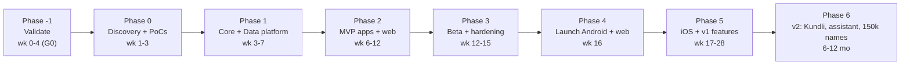
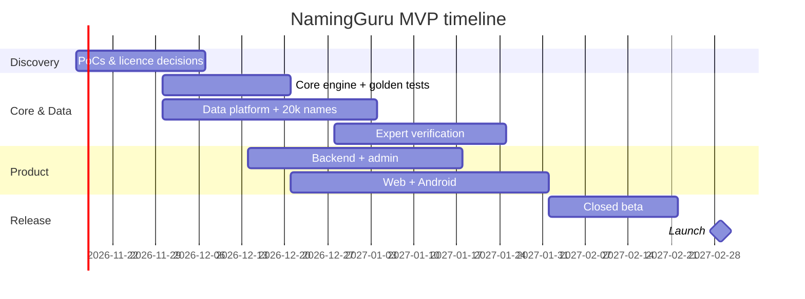

# 10 – Roadmap & Work Breakdown Structure

## 1. Phases

> **Validate first (adopted from the earlier study, [doc 12](12-Input-Reconciliation.md)).** Phase 0 below now begins with a 4-week validation sprint (landing page + waitlist with ₹199 vs ₹299 price test, 15–20 parent interviews, competitor audit, SEO keyword research). Continue to build only if waitlist and interest are meaningful (gate G0). Timeline weeks below are counted **from the end of G0**. MVP is **web-first with 3 languages**; Android follows traction evidence.

| Phase | Deliverables | Exit gate (SS-08) |
| :-- | :-- | :-- |
| P0 Discovery | PoC-1…5, licence decisions, tech spike, legal opinion on sources | G1 Define/Design |
| P1 Core + Data | `@namingguru/core` with golden tests; ingestion→dedupe→enrich pipeline; 20k candidates; schema; admin console v0 | G2 Measure baseline; G3 data accuracy ≥ 99% sample |
| P2 MVP | API, web (SEO pages), Android app, filters, numerology, nakshatra, shortlist, share | G4 Test gate |
| P3 Beta | 200 families, 8 experts reviewing, perf & a11y, DPDP checklist | G5 Release gate |
| P4 Launch | Play + web live; monitoring; support | G6 Hypercare exit (2 weeks) |
| P5 v1 | iOS, UGC, trend scores, regional languages UI, PDF reports, audio top 2k | G7 Improve |
| P6 v2 | Kundli matching, AI assistant (RAG), 150k names, premium, partnerships | G8 Control handover |

## 2. Work breakdown structure

| WBS | Work package | Effort (person-days) | Depends on |
| :-- | :-- | :-- | :-- |
| 1 | **Project management & quality** | 15 | – |
| 1.1 | Charter, plans, Six Sigma artefacts (SS-01…08) | 4 | – |
| 1.2 | Sprint ceremonies, risk reviews | 11 | 1.1 |
| 2 | **Core engine** | 18 | – |
| 2.1 | Letter mappings, reducer, transliteration | 5 | – |
| 2.2 | Nakshatra module + ayanamsa + tz handling | 6 | 2.1 |
| 2.3 | Compatibility matrix + predictions content model | 3 | 2.1 |
| 2.4 | Golden tests (500) + property tests | 4 | 2.1–2.3 |
| 3 | **Data platform** | 35 | – |
| 3.1 | Source extractors (Wikidata, scripture corpora, datasets) | 8 | – |
| 3.2 | Normalise + dedupe + phonetic key | 6 | 3.1 |
| 3.3 | AI classify/enrich via OmniRoute + guardrails | 6 | 3.2 |
| 3.4 | Review queue + curator console | 8 | 3.3 |
| 3.5 | Expert onboarding, 20k verification | 7 (+external) | 3.4 |
| 4 | **Backend** | 25 | 2, 3 |
| 4.1 | Schema, migrations, search (trgm/FTS) | 6 | – |
| 4.2 | Names, shortlist, auth, suggestions APIs | 9 | 4.1 |
| 4.3 | Snapshot builder + CDN publish | 4 | 4.1 |
| 4.4 | Reports/PDF, share links | 3 | 4.2 |
| 4.5 | Observability, rate limits, security hardening | 3 | 4.2 |
| 5 | **Clients** | 45 | 2, 4 |
| 5.1 | Design system, Indic fonts, i18n | 6 | – |
| 5.2 | Web (Next.js, SEO pages) | 12 | 4 |
| 5.3 | Mobile (Expo; offline SQLite) | 18 | 4 |
| 5.4 | Accessibility + performance work | 4 | 5.2, 5.3 |
| 5.5 | Analytics, remote config | 5 | – |
| 5.6 | Social poll (module, voter web page, results dashboard) | 8 | 4.2 |
| 5.7 | Scorecard: char count, misspelling, family-initial checks | 5 | 2.1 |
| 0 | **Validation sprint (G0)**: landing page, waitlist, 15–20 interviews, competitor audit (top 10 sites + top 10 apps), keyword research | 12 | – |
| 6 | **Content** | 20 | – |
| 6.1 | Number predictions (1–9, 10–52) authoring + review | 8 | – |
| 6.2 | Translations (UI + predictions, 6 languages) | 8 | 6.1 |
| 6.3 | Editorial & tone guide | 4 | – |
| 7 | **QA & release** | 18 | – |
| 7.1 | Test automation (unit/e2e/load) | 8 | – |
| 7.2 | Beta programme, feedback loop | 6 | 5 |
| 7.3 | Store submissions & launch | 4 | 7.2 |
| 8 | **Legal & compliance** | 6 | – |
| | **Total** | **≈ 207 pd (≈ 9.9 pm)** | with AI agents ≈ 7 pm |

## 3. Milestones

> **Scope per product-owner decisions ([doc 12 §4.1](12-Input-Reconciliation.md)):** Tamil-only MVP, AI-curated content, lean budget, **reuse the existing donorconnect.in infra (no new paid infra)**, ads first, subscription later. The overall plan above is unchanged; only milestones are re-based. Week targets are indicative.

| M | Milestone | Key outcomes | Target |
| :-- | :-- | :-- | :-- |
| M0 | **Free-infra foundation** (initial milestone) | Subdomain on donorconnect.in infra (e.g. names.donorconnect.in); separate DB/schema; CI deploy to the existing host; confirm headroom (CPU/RAM/disk); AI model access + usage cap; zero new infra spend | Week 2 |
| M1 | Core engine + Tamil seed data | Numerology/nakshatra core with golden tests; first ~2k Tamil names via AI pipeline (source fetch → AI draft → AI cross-check → confidence score) | Week 5 |
| M2 | Tamil name catalogue at scale | ~20k Tamil names with sources and confidence labels; "report error" flow; spot-check sample | Week 8 |
| M3 | Web MVP live with ads | Tamil-first SEO pages, search/filters, numerology, nakshatra, shortlist; ad slots + DPDP consent banner; analytics | Week 11 |
| M4 | Public feedback loop | Public name/meaning suggestion form; AI moderation + auto-approve rules; usage and ad-revenue tracking | Week 14 |
| M5 | Scale & monetise trigger | Review subscriber/MAU threshold; enable disabled paywall/subscription; evaluate Android app and other languages (Hindi/Telugu) | After threshold met |
## 4. Gantt (simplified)

## 5. Team & RACI (MVP)

| Activity | Lead dev | Mobile/FE | Curator | Experts | Designer | Owner |
| :-- | :-- | :-- | :-- | :-- | :-- | :-- |
| Architecture | **A/R** | C | I | – | – | I |
| Core engine | **A/R** | C | – | C | – | I |
| Data pipeline | **A** | I | **R** | C | – | I |
| Verification | I | – | **A** | **R** | – | I |
| Apps/web | C | **R** | – | – | C | **A** |
| QA/release | **A** | R | I | – | – | I |

