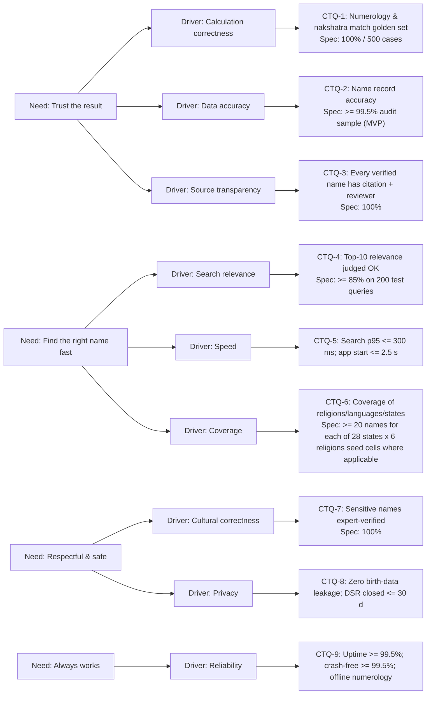

# SS-02 – Voice of Customer (VOC) & CTQ Tree (Define)

## 1. VOC collection plan

| Method | Sample | When | Output |
| :-- | :-- | :-- | :-- |
| Structured interviews | 20 parents/expecting couples across 6 regions & 5 religions | Wk 1–3 | Needs, pain points |
| Elder/pandit interviews | 10 | Wk 1–3 | Tradition rules, trust factors |
| Competitor review (apps/sites) | 10 products | Wk 1–2 | Gaps, errors catalogue |
| Survey (WhatsApp/Google Forms) | 300 | Wk 2–4 | Priority ranking (Kano) |
| Beta feedback & in-app reports | 200 families | Wk 12–15 | Defects, CSAT |

## 2. Representative VOC → needs (to be replaced by real data)

| Verbatim (hypothesis) | Need | Source |
| :-- | :-- | :-- |
| “Grandmother wants a name starting with *Ka* from nakshatra.” | Nakshatra-based start letters | Elder |
| “Every site gives a different numerology number.” | Consistent, explainable calculation | Parent |
| “Is this name really Sikh/Muslim? Meaning looks wrong.” | Verified, religion-appropriate meaning with source | Parent |
| “I want something modern but easy for relatives abroad.” | Ease-of-call, trend | Parent |
| “Names from my state/language are missing.” | Regional coverage | Parent |
| “Don’t want to give my birth details to a random app.” | Privacy | Parent |
| “Site is slow / full of ads on my phone.” | Speed, low data | Parent |

## 3. Kano classification

| Feature | Category |
| :-- | :-- |
| Correct numerology number | Must-be |
| Meaning displayed | Must-be |
| Filter by religion/gender/letter | Must-be |
| Nakshatra → letters | Performance (high for Hindu) |
| Ease-of-call score | Performance |
| Regional script display | Performance |
| Sibling harmony, nickname warnings | Delighter |
| Pronunciation audio | Delighter |
| Share PDF/WhatsApp with family | Delighter |
| Social “vote-out” poll (relatives remove names with reasons) | Delighter / differentiator (to validate in G0) |
| Evaluation scorecard (misspelling, length, family match) | Performance |

## 4. CTQ tree

## 5. CTQ specification table

| CTQ | Metric (operational definition) | USL / LSL | Measurement system | Owner |
| :-- | :-- | :-- | :-- | :-- |
| CTQ-1 | Mismatches ÷ golden test cases | 0 | CI test suite | Lead dev |
| CTQ-2 | Defective fields ÷ total fields audited (gender, religion, language, meaning, origin) | ≤ 0.5% (MVP), ≤ 0.1% (v1) | Weekly 300-record blind audit by 2 reviewers | Data steward |
| CTQ-3 | Verified records lacking citation or reviewer ÷ verified records | 0 | DB constraint + query | Data steward |
| CTQ-4 | Queries with relevant top-10 ÷ test queries | ≥ 85% | Panel scoring | Product |
| CTQ-5 | p95 latency | ≤ 300 ms / ≤ 2.5 s | APM, RUM | Lead dev |
| CTQ-6 | Seed cells meeting minimum count | ≥ 95% of applicable cells | SQL coverage report | Curator |
| CTQ-7 | Sensitive records without expert sign-off | 0 | Review log | Curator |
| CTQ-8 | Privacy incidents / DSR late | 0 / 0 | Incident log | DPO |
| CTQ-9 | Availability, crash-free | ≥ 99.5% | Uptime monitor, Crashlytics | Ops |

## 6. Measurement System Analysis (MSA) plan
* **Attribute agreement analysis** for name-record audits: 2 reviewers + 1 expert on 100 records → **Kappa ≥ 0.8** before the audit is trusted.
* **Gage R&R** (relevance panel scoring): 5 raters × 20 queries × 2 repeats; reproducibility ≥ 90%.
* Calibration session when Kappa < 0.8.

