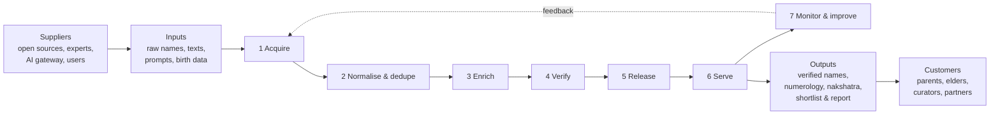

# SS-03 – SIPOC (Define)

## 1. SIPOC – Name data & engine value stream

| Suppliers | Inputs | Process (high level) | Outputs | Customers |
| :-- | :-- | :-- | :-- | :-- |
| Wikidata/Wikipedia, scripture corpora, lexicon providers, open datasets | Raw names, texts, licences | **1.** Acquire & log provenance | Raw records with source IDs | Data pipeline |
| Data pipeline | Raw records | **2.** Normalise, transliterate, dedupe | Clean unique candidates | Enrichment |
| OmniRoute / LLM providers | Candidate names + prompts | **3.** Classify & draft meaning, ease-of-call | Enriched drafts + confidence | Review queue |
| Domain experts, curators | Drafts needing verification | **4.** Verify & approve | Verified records | Release builder |
| Engineering | Verified dataset, core library | **5.** Build index, snapshot, release | `names-YYYY.MM.N`, SQLite snapshot | Apps / web / API |
| Apps/web/API | Release + user inputs (DOB, filters) | **6.** Compute numerology, nakshatra, search | Shortlist, report | Parents & elders |
| Users | Feedback, reports, suggestions | **7.** Monitor, triage, improve | Fixes, new releases | Curators, engineers |

## 2. SIPOC diagram

## 3. Process-step ownership & key measures

| Step | Owner | Critical output | Key measure (SS-04) |
| :-- | :-- | :-- | :-- |
| 1 Acquire | Data engineer | Source register entry | % records with licence + provenance |
| 2 Normalise & dedupe | Data engineer | Unique canonical names | Duplicate escape rate |
| 3 Enrich | AI/data steward | Draft with confidence | Draft acceptance rate; JSON validity |
| 4 Verify | Curator/experts | Verified record | Audit DPMO; review cycle time |
| 5 Release | Lead dev | Dataset release | Release defects; snapshot size |
| 6 Serve | Lead dev | Results | Latency, correctness, crash-free |
| 7 Monitor | Ops/PO | Fix backlog | Mean time to correct a reported error |

