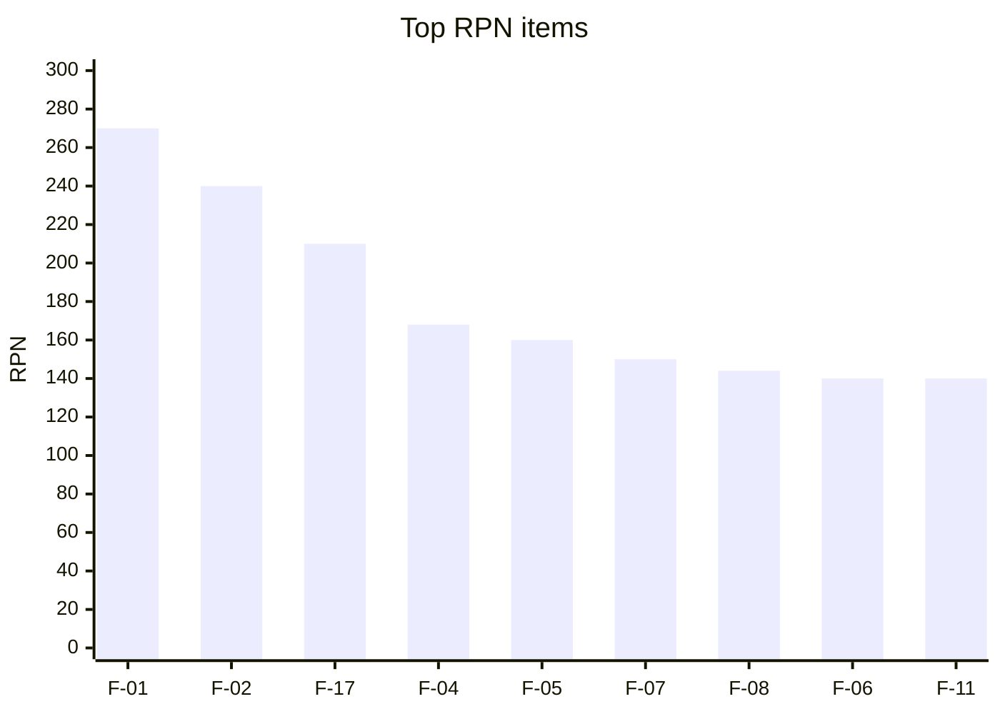

# SS-05 – FMEA (Analyze)

**Scale:** Severity (S), Occurrence (O), Detection (D) each 1–10; **RPN = S × O × D**. Action threshold: RPN ≥ 120 or S ≥ 9.
Ratings below are initial expert estimates to be recalibrated with Measure-phase data.

## 1. Process/Design FMEA

| ID | Process step / function | Failure mode | Effect | S | Cause | O | Current control | D | RPN | Recommended action | Owner | Target RPN |
| :-- | :-- | :-- | :-- | :-- | :-- | :-- | :-- | :-- | :-- | :-- | :-- | :-- |
| F-01 | Enrich: religion classification | Name tagged with wrong religion | Offence, loss of trust | 9 | LLM hallucination; shared names across faiths | 6 | Confidence score | 5 | **270** | Expert sign-off for all religion-sensitive names; multi-religion tag support; ≥2-source rule | Curator | 54 |
| F-02 | Enrich: meaning | Incorrect/invented meaning | Wrong choice, ridicule | 8 | LLM hallucination, folk etymology | 6 | Citation field | 5 | **240** | Citation mandatory; lexicon cross-check; blind audit 5% | Data steward | 64 |
| F-03 | Engine: letter mapping | Wrong mapping table (e.g. Chaldean 9) | Wrong number for all users | 9 | Spec error | 3 | Code review | 3 | 81 | Two-numerologist review; 500 golden tests; mapping as signed data file | Lead dev | 27 |
| F-04 | Engine: transliteration | Spelling variation changes number | User confusion | 6 | Multiple valid spellings | 7 | Show transliteration | 4 | 168 | Editable spelling, variant advisor, explain on screen | Lead dev | 60 |
| F-05 | Nakshatra: time zone | Wrong UTC offset for birth place/time | Wrong nakshatra | 8 | Historic tz, DST, user error | 5 | IANA tzdata | 4 | 160 | Place autocomplete with tz, show UTC used, manual offset override, boundary warning | Lead dev | 48 |
| F-06 | Nakshatra: ayanamsa | Different ayanamsa gives different pada | Mismatch with family pandit | 7 | Tradition variance | 5 | Lahiri default | 4 | 140 | Selectable ayanamsa; boundary notice; both letter sets near edge | Lead dev | 42 |
| F-07 | Dedupe | Duplicates or wrongly merged variants | Clutter / lost names | 5 | Phonetic key collisions | 6 | Fuzzy match | 5 | 150 | Variant clusters instead of hard merge; audit sample | Data engineer | 60 |
| F-08 | Source acquisition | Using data with incompatible licence | Legal claim, takedown | 9 | Unknown dataset licence | 4 | Source register | 4 | 144 | Legal gate before ingest; licence field mandatory; no scraping commercial sites | Product owner | 36 |
| F-09 | Community tagging | Algorithmic caste/community inference | Discrimination, outrage | 10 | Misuse of LLM output | 3 | Policy | 3 | 90 | Hard rule: expert/user tagging only; automated test that blocks auto tags | Curator | 30 |
| F-10 | Predictions content | Fear-inducing or harmful statements | Distress, app-store issues | 8 | AI paraphrase, source text | 4 | Editorial guide | 4 | 128 | Tone linting rules; reviewer approval; no health/death predictions | Content editor | 48 |
| F-11 | Search | Transliteration mismatch (no result) | Frustration | 5 | Spelling diversity | 7 | Fuzzy | 4 | 140 | Phonetic key tuning; synonym table; log zero-results weekly | Lead dev | 50 |
| F-12 | Offline snapshot | Stale/corrupt snapshot | Wrong or missing data | 6 | Failed sync, hash mismatch | 4 | Version check | 3 | 72 | Manifest hash, atomic swap, rollback | Mobile dev | 36 |
| F-13 | AI gateway | Free-tier quota exhausted/ToS change | Pipeline stall | 5 | Provider limits | 7 | OmniRoute fallback | 3 | 105 | Paid alias, batch checkpointing, budget alerts | Data engineer | 45 |
| F-14 | Privacy | Birth data leaked in logs / to LLM | Legal breach (DPDP), trust loss | 10 | Debug logging, prompt composition | 3 | Code review | 4 | **120** | Data-flow diagram review; log scrubbing tests; birth data never leaves device by default; no PII in prompts | Lead dev | 40 |
| F-15 | Auth/OTP | SMS cost explosion / fraud | Cost, abuse | 5 | OTP pumping | 5 | Rate limits | 4 | 100 | Guest mode, Google login, captcha + per-IP/device limits | Lead dev | 40 |
| F-16 | Release | Regression ships to prod | Outage, wrong results | 7 | Missing tests | 4 | CI | 3 | 84 | Canary, auto-rollback, golden tests blocking | Lead dev | 42 |
| F-17 | Secrets | API key committed to repo/doc | Quota theft, cost | 7 | Plain-text keys in docs (observed in OmniRoute reference) | 5 | None | 6 | **210** | Secret scanning in CI, pre-commit hook, env vars only, rotate exposed key | Lead dev | 35 |
| F-18 | Ephemeris licence | AGPL obligations triggered for closed code | Forced source disclosure | 8 | Using Swiss Ephemeris in SaaS | 4 | Decision tree (doc 06) | 3 | 96 | MVP uses MIT lib; legal decision before Swiss Ephemeris use | Product owner | 32 |
| F-19 | UGC | Spam/offensive suggestions | Brand damage | 6 | Open submissions | 5 | Moderation | 4 | 120 | Profanity filter, rate limit, review queue | Curator | 48 |
| F-20 | Pronunciation audio | Mispronounced name via TTS | Embarrassment | 4 | TTS limits for Indic | 6 | Spot check | 5 | 120 | Human audio for top 2k, flag “auto audio” | Content | 60 |
| F-21 | Social poll | Comment abuse, family conflict, or voter/child data exposure via shared link | Family harm, DPDP breach | 8 | Open links forwarded; harsh comments; long retention | 5 | Private link, parent-only comments | 4 | 160 | Unguessable tokens, voters never see others’ comments, profanity filter, rate limits, auto-delete after close, consent text, parent can delete comments (doc 11 §6) | Lead dev | 48 |
| F-22 | Scorecard: uniqueness | Percentile shown without trustworthy frequency data | Misleading claim, loss of trust | 6 | No open frequency source | 7 | “Estimate” label | 4 | 168 | Hide until S15 partner data exists; show band only, labelled “estimate”; document method | Product owner | 42 |
| F-23 | Scorecard: pronunciation/akshara count | Code-point counting instead of grapheme clusters; wrong length or pronunciation score | Wrong limit warnings | 5 | Naive string length on Indic scripts | 6 | Unit tests | 3 | 90 | Grapheme-cluster library, golden tests per script | Lead dev | 30 |
| F-24 | Validation | Build proceeds without demand evidence | Wasted build effort | 7 | Skipping G0 | 4 | Stage gate G0 | 3 | 84 | Enforce G0 criteria (waitlist, price test) before Phase 1 spend | Product owner | 42 |

## 2. Pareto of RPN (top contributors)

The first four items account for ≈ 55% (888 of 1,622) of the cumulative RPN of the top-9 → primary improvement focus (data trust, secrets, transliteration).

## 3. Root-cause analysis highlights (5-Why, F-01)

1. Why is religion wrong? → The model guessed from the name string.
2. Why guess? → Prompt allowed answers without evidence.
3. Why allowed? → No citation/confidence requirement.
4. Why no requirement? → Pipeline built for speed.
5. Why not gated? → No expert capacity planned. **Fix:** expert review capacity (150 names/hour) funded; evidence-required prompt; auto-accept only for non-sensitive.

## 4. Improvement verification
Recalculate RPN after actions (target column); items must reach RPN < 120 and S ≥ 9 items must have ≥ 2 independent controls before gate G5.
