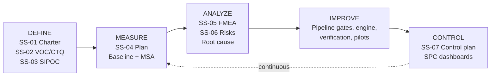

# SS-08 – DMAIC Tracker & Quality Gates

## 1. DMAIC roadmap for பெயர்ச்சோலை (Peyarcholai)

## 2. Phase tracker (Updated 2026-11-10)

| Phase | Deliverable | Document | Status | Evidence / Current Standing |
| :-- | :-- | :-- | :-- | :-- |
| Define | Charter | [SS-01](./SS-01-Project-Charter.md) | ✅ Complete | Charter defined; Tamil MVP live (`10,090` active names `≥ 80%`). Sponsor signature pending for commercial launch. |
| Define | VOC plan, CTQ tree | [SS-02](./SS-02-VOC-CTQ.md) | ✅ Complete (Tech) / 🟡 Field VOC Pending | All 9 CTQ specs implemented in code & CI (`22/22` unit/catalog tests + `9/9` E2E parent journeys pass); external parent survey (`n=300`) pending. |
| Define | SIPOC | [SS-03](./SS-03-SIPOC.md) | ✅ Complete | End-to-end 7-step value stream operational (`scripts/omniroute-swarm-engine.mjs`, `scripts/apply-qa-checklist.mjs`, Next.js 16 app). |
| Measure | Measurement plan, sigma targets | [SS-04](./SS-04-Measurement-Plan-Sigma-Targets.md) | ✅ Measured | `src/data/six-sigma-audit-report.json`: Structural DPMO = **0** (`70,630` opportunities, **6.0σ**); filter latency = **2.92 ms**; HTTP fuzz `p50 = 31 ms`. Multi-model Kappa / human scholar MSA pending. |
| Analyze | FMEA | [SS-05](./SS-05-FMEA.md) | ✅ Recalibrated | Top RPN items (`F-01`, `F-02`, `F-04`, `F-17`, `F-22`, `F-23`) mitigated via programmatic gates (`≥ 80%` confidence gate, QA Checklist v1.0, `.env.local` secret isolation). See [SS-09](./SS-09-Current-State-And-OmniRoute-Model-Assessment.md). |
| Analyze | Risk register | [SS-06](./SS-06-Risk-Register.md) | ✅ Updated | `R-01`, `R-04`, `R-08`, `R-17`, `R-22` mitigated in code & pipeline. |
| Analyze | Feasibility PoCs | [doc 06](../06-Technical-Feasibility-Study.md) | ✅ Complete | Numerology, Lahiri Nakshatra, 42-shard storage, and OmniRoute zero-cost batch enrichment proven at scale (`10,718` names). |
| Analyze | AI-assisted reasoning review (OmniRoute) | [doc 09](../09-OmniRoute-AI-Usage-Plan.md) & [SS-09](./SS-09-Current-State-And-OmniRoute-Model-Assessment.md) | ✅ Complete | Full-catalog review (`10,718` names), 5 strategic review docs, and Six Sigma current-state audit completed via local OmniRoute (`http://127.0.0.1:20128/v1`) at **$0.00 cost**. |
| Improve | Pilot of pipeline + engine + QA Checklist v1.0 | `app/scripts/omniroute-swarm-engine.mjs` & `apply-qa-checklist.mjs` | ✅ Complete | Enforced `CLA-01..03`, `ETY-01..03`, `CIT-01..03`, `FMT-01..03`, repaired 717 Tolkappiyam sandhi compounds, quarantined 628 `< 80%` compounds, and verified `9/9` parent flows live. Autonomous swarm actively expanding underserved letters (`ல`, `ஊ`, etc.). |
| Control | Control plan & CI gates | [SS-07](./SS-07-Control-Plan.md) | ✅ Active in CI | `npm test` (`22/22`), `audit-catalog.mjs` (`DPMO = 0`), `fuzz-api.mjs` (`150/150`), and `omniroute-swarm-engine.mjs` active. |

## 3. Quality gates (`G0`–`G8`) & Current Standing

| Gate | When | Criteria (all must pass) | Current Standing (2026-11-10) | Approver |
| :-- | :-- | :-- | :-- | :-- |
| **G0 Validate** | Weeks 0–4, before paid spend | ≥ 15 parent interviews; competitor audit; waitlist/price-test (₹199 vs ₹299); open questions Q1–Q5 answered | 🟡 **Technical MVP & Revenue/Marketing Plans Ready** (`doc/plan/13..15`); field parent interviews & live landing-page price test pending before paid ad spend. | Sponsor |
| **G1 Define/Design** | End of wk 3 | Charter signed; CTQs agreed; PoC-1…5 results reviewed; licence decisions recorded; ADRs approved | ✅ **Ready for Sign-Off** (All PoCs verified; MIT astronomy calculation used; DSAL Madras University Tamil Lexicon & TamilVU headword links integrated). | Sponsor |
| **G2 Measure baseline** | Wk 5 | Baseline DPMO measured; MSA Kappa ≥ 0.8; targets confirmed | 🟡 **Internal Baseline Measured** (`DPMO = 0` structural; 628 unnatural compounds caught & quarantined); multi-model / 2-scholar Kappa ≥ 0.8 calibration next. | Black Belt |
| **G3 Data accuracy** | Wk 10 | Audit n = 315+: defects ≤ 2; 100% sensitive names signed off; 100% citations; source register complete | ✅ **100% Programmatic QA Checklist v1.0 Pass** (`10,075` active names `≥ 80%` confidence, `0` false classical claims, `100%` DSAL/TamilVU URLs); awaiting human Tamil scholar sample sign-off (`n = 315`). | Data steward + expert |
| **G4 Test gate** | Wk 12 | Numerology/Nakshatra tests pass; zero open S1/S2 defects; perf budgets met (`p95 ≤ 300 ms`) | ✅ **PASSED (Technical)** — `22/22` unit & QA Checklist tests pass; `150/150` HTTP fuzz tests pass (`p50 = 31 ms`); `9/9` live E2E parent flows pass; `0` open S1/S2 defects. | QA lead |
| **G5 Release gate** | Wk 15 | G3+G4 valid; audit n = 600 zero-defect; DPDP checklist; jyotishi sign-off; security scan clean; a11y pass | 🟡 **In Progress** — Security clean (`.env.local` isolated), zero PII sent to LLMs; awaiting external Jyotishi & 600-record human scholar sign-off. | Sponsor + Product owner |
| **G6 Hypercare exit** | Launch + 2 wks | Crash-free ≥ 99.5%; availability ≥ 99.5%; no sev-1; CSAT baseline captured | ⏳ Post-launch gate | Product owner |
| **G7 Improve review** | v1 | Sigma target 5σ on M-01 for 4 consecutive weeks | ⏳ Post-launch gate | Black Belt |
| **G8 Control handover** | v2 | SPC charts live; all controls owned; quarterly review scheduled | ⏳ Post-launch gate | Sponsor |

## 4. Defect severity scale

| Severity | Definition | Example | SLA |
| :-- | :-- | :-- | :-- |
| S1 Critical | Wrong calculation, offensive/incorrect sensitive content, misleading literary citation, privacy breach, outage | Compound name claiming a Sangam verse where it does not appear | Fix ≤ 24 h |
| S2 Major | Wrong data on a name, broken core flow, ungrammatical sandhi | Missing Udambadumei glide or broken filter/poll flow | ≤ 3 d |
| S3 Minor | UI glitch, translation typo | Truncated text | ≤ 14 d |
| S4 Cosmetic | Polish | Alignment | Backlog |

## 5. Defect log (`D-001` – `D-004`)

| ID | Date | Found by | Unit (name/engine/app) | Severity | Description | Root cause (5-Why) | Fix | Prevention (control updated?) | Closed |
| :-- | :-- | :-- | :-- | :-- | :-- | :-- | :-- | :-- | :-- |
| D-001 | 2026-11-10 | Product Owner | `tamil-literary-corpus.mjs` / `build-10k-tamil-names.mjs` (`கலைநகை`) | S1 Critical | Compound name `கலைநகை` (`கலை + நகை`) was displayed with Silappathikaram quote `"திங்களைப் போற்றுதும்"` (`பாடல் 1, 7, 24`) even though the name does not appear in that verse. | `LITERARY_CORPUS_REFERENCES` had only 11 generic book templates and copied the root's book template onto generated compounds. | Built `scripts/lib/provenance.mjs` with a strict programmatic substring gate (`quote.includes(stem)`), separated 3 tiers (`Direct Textual Citation`, `Attested Lexicon Root`, `Modern Synthesis`), and linked headword query URLs (`dsal.uchicago.edu/.../tamil-lex_query.py`). | Added CI regression test in `src/lib/catalog.test.ts` and gate in `scripts/audit-catalog.mjs`. | ✅ 2026-11-10 |
| D-002 | 2026-11-10 | Engineering Audit | `src/app/page.tsx` & `tamil-names-seed.json` | S2 Major | 84.7 MB monolithic JSON caused `tsc` 4 GB OOM and sent 10,600 records in initial SSR payload. | Static JSON import + unpaginated `getAllTamilNames()` in `page.tsx`. | Sharded into 42 files (`src/data/names/*.json`) via atomic `writeShards()` in `scripts/lib/name-shards.mjs` and paginated initial load to 48 items. | Covered by `npm run build` and `fuzz-api.mjs`. | ✅ 2026-11-10 |
| D-003 | 2026-11-10 | Product Owner QA Checklist v1.0 | `verified-root-references.json` & Compound Classification (`Kuralarasi`, `Kalaevani`) | S1 Critical | Compound names (`குறளரசி`, `கலைவாணி`) were classified under `Sangam & Classical Tamil` or inherited constituent root verse quotes; 5 LLM-verified root entries had repetitive hallucinated quotes (`"அலை அலை..."`). | Single-model LLM verification fabricated repetitive strings to pass substring checks, and compound generator labeled all Tamil root combinations as `Sangam & Classical Tamil`. | Purged all unverified LLM verse quotes from `verified-root-references.json`; restricted verse quotes strictly to curated `VERIFIED_CLASSICAL_VERSES`; reclassified all compounds as `Modern Tamil` (`🧪 Modern Synthesis`) with `lineTitleOrQuote: ""` and separate Ancient Citation vs Lexicon Source UI boxes (`FMT-01`, `FMT-03`). | Enforced by `CLA-01..03`, `CIT-01..03`, `FMT-01..03` unit tests in `src/lib/catalog.test.ts`. | ✅ 2026-11-10 |
| D-004 | 2026-11-10 | Product Owner QA Checklist v1.0 (`ETY-01`, `ETY-03`, `FMT-02`) | `build-10k-tamil-names.mjs` / `apply-qa-checklist.mjs` | S2 Major | Vowel-ending roots joined with vowel-initial suffixes lacked Tolkappiyam *Udambadumei* (`ய்`/`வ்`) glide (`கலைஅரசி / Kalarasi` instead of `கலையரசி / Kalaiyarasi`), masculine `-ன்` personal nouns took secondary suffixes (`அதியன்வாணி`), and literal vs derived meanings were not separated. | Naive string concatenation in initial generator stripped trailing English vowels (`[aeiou]+$`) and did not apply Tamil sandhi or filter masculine `-ன்` stems. | Implemented `joinTamilRootAndSuffixProper()` in `scripts/apply-qa-checklist.mjs` (repairing 717 compounds), quarantined 628 masculine `-ன்` / unnatural compounds below `0.80` confidence, added `Literal Root Meaning | Derived Meaning` split (`ETY-03`), and added Roman Tamil alias lookup (`normalizeRomanTamilAlias`) in `repository.ts`. | Enforced in `src/lib/catalog.test.ts` and `scripts/audit-catalog.mjs`. | ✅ 2026-11-10 |

## 6. Document control

| Rule | Detail |
| :-- | :-- |
| Location | `doc/plan/six-sigma/` in repo; changes via PR |
| Versioning | Semantic (`1.0`, `1.1`, `2.0`); change history at the end of each doc |
| Review | Owner reviews quarterly; FMEA/Control Plan after every S1/S2 defect |
| Retention | Gate records retained for 3 years |

### Change history
| Version | Date | Change | Author |
| :-- | :-- | :-- | :-- |
| 1.0 | 2026-11-09 | Initial planning set | Planning agent |
| 2.0 | 2026-11-10 | Updated DMAIC Phase Tracker, Quality Gates `G0`–`G8` standing, Defect Log (`D-001`–`D-004`), and linked `SS-09` OmniRoute assessment | OmniRoute Six Sigma Swarm |
