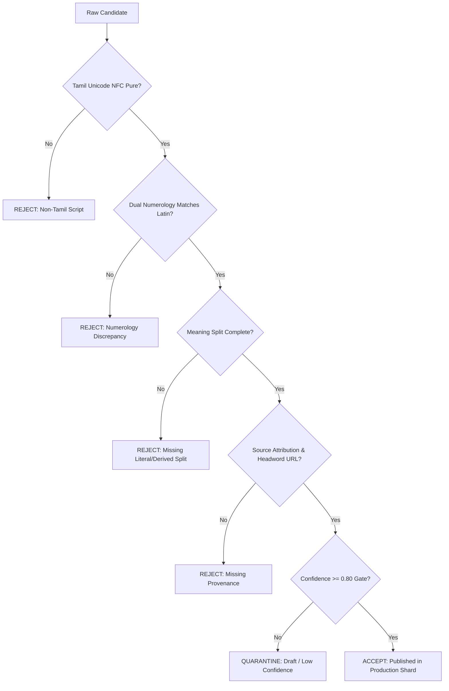

# 03 – Name Sourcing Data Quality Acceptance Criteria (QAC)

**Document Reference:** `doc/testing/03-Name-Sourcing-Data-Quality-Acceptance-Criteria.md`  
**Governing Documents:**  
- `doc/requirements/02-Naming-Source-Chatgpt.md` (Authentic Sourcing Strategy & Knowledge Base)  
- `doc/requirements/02-Name-Sourcing-Strategy.md` (Channels S1–S14, Verification Queue, Coverage Matrix)  
- `doc/requirements/05-Literary-Sources-Tolkappiyam-Ramayanam-Directory.md` (Classical Text Corpus & Inscription Archives)  
- `doc/plan/six-sigma/SS-08-DMAIC-Tracker-Quality-Gates.md` (Six Sigma Quality Gates G1–G5)  

---

## 1. Executive Summary & Quality Objective

Every name in **பெயர்ச்சோலை (Peyarcholai)** must function as a verified, linguistically accurate record rather than a scraped list item. The Six Sigma defect tolerance target across all active published names is **Zero Critical Defects ($DPMO \le 3.4$)**.

This document defines the **Data Quality Acceptance Criteria (DQAC)** that each incoming record must satisfy before passing Gate G3 (Verification Queue) and entering the published production shards.

---

## 2. Source Channel Hierarchy & Trust Tiers (S1–S14)

Per `02-Name-Sourcing-Strategy.md`, every ingested record must declare its origin channel and adhere to its specific acceptance rules:

| Tier | Source Channels | Description & Examples | Acceptance Criteria & Gate Rules |
| :--- | :--- | :--- | :--- |
| **Tier 1: Canonical / Gold** | **S2, S3, S5** | Ancient Epics, Sangam Literature, Tolkappiyam, Kamba Ramayanam, Madras University Tamil Lexicon, TVA, CICT. | **Direct Textual Citation or Attested Lexicon Headword required.** Verse number or Lexicon headword URL mandatory. Confidence must be $\ge 0.90$. |
| **Tier 2: Structured / Silver** | **S1, S4, S8** | Wikidata, open religious texts (Quranic, Biblical, Jain Agam, Sikh GGS), community expert submissions. | Dual independent cross-reference required. Meaning text must be freshly composed (no commercial scraping). Confidence $\ge 0.85$. |
| **Tier 3: Synthetic / Modern** | **S10, S14** | Newly coined names from authentic Tamil roots via OmniRoute or morphological generators. | **Strict Tolkappiyam Sandhi rules applied.** Must explicitly split into `root1 + root2`, separate `literalMeaningEn` vs `derivedMeaningEn`, and be tagged `Modern Tamil` (`🧪 Modern Synthesis`). Never claim ancient poem citations. |
| **Tier 4: Candidate / Untrusted** | **S6, S9, S11** | Kaggle datasets, UGC submissions, social media trend signals. | **Quarantined by default.** Confidence $< 0.80$. Never published until promoted through expert or OmniRoute lexical verification. |

---

## 3. Mandatory 14-Dimension Data Quality Acceptance Matrix

Every record must contain complete, non-null, strongly-typed values across all 14 dimensions:



### Detailed Criteria per Dimension:

| # | Dimension Field | Type | Acceptance Criteria (Must Pass) | Failure / Defect Definition | Severity |
| :-- | :-- | :-- | :-- | :-- | :-- |
| 1 | `nameTamil` | String | Pure Tamil Unicode script (`[\u0B80-\u0BFF]`), normalized to Unicode NFC. No Sanskrit Devanagari characters, no trailing spaces or ASCII punctuation. | Contains non-Tamil script, Latin characters, or invalid diacritic sequences. | **Critical (Class A)** |
| 2 | `nameLatin` | String | Standard English transliteration matching Tamil phonetics (e.g., `Yazhini`, `Kalaiyarasi`, `Vennilaa`). Starts with capital letter, rest lowercase. | Corrupted transliteration, vowel stripping (e.g. `Kalaevani` for `கலைவாணி`), or special symbols. | **Major (Class B)** |
| 3 | `slug` | String | Unique lowercase alphanumeric identifier (`[a-z0-9]`). Matches `nameLatin` normalized. Must be unique across all 43 shards. | Duplicate slug, uppercase characters, hyphens, or collision with existing record. | **Critical (Class A)** |
| 4 | `gender` | Enum | Strictly one of `"boy"`, `"girl"`, or `"unisex"`. Culturally accurate in Tamil tradition. | `"male"`, `"female"`, `"unknown"`, or wrong cultural gender assignment (e.g. `-an` masculine ending marked as girl). | **Major (Class B)** |
| 5 | `originCategory` | Enum | Strictly `"Classical / Sangam Tamil"`, `"Medieval Tamil"`, `"Modern Tamil"`, or `"Traditional Tamil (Lexicon Root)"`. | Compound names labeled as `"Classical / Sangam Tamil"`, or arbitrary unvetted category strings. | **Critical (Class A)** |
| 6 | `meaningTa` | String | Natural, grammatically sound Tamil definition ($\ge 10$ characters). No mechanical translation jargon. | Blank, Devanagari text, English words inside Tamil meaning, or machine gibberish. | **Major (Class B)** |
| 7 | `meaningEn` | String | Natural, dignified English definition ($\ge 15$ characters). Clear, parent-friendly prose. | Tautological boilerplate (e.g. "Name meaning combined with..."), typographical errors. | **Major (Class B)** |
| 8 | `literalMeaningEn` | String | Explicit literal meaning of constituent roots (e.g. `"யாழ் (ancient Tamil harp) + இனி (sweetness)"`). | Identical copy-paste of derived meaning without root breakdown for compound names. | **Minor (Class C)** |
| 9 | `derivedMeaningEn` | String | Poetic, contextual, and cultural significance in English. | Absent or incoherent phrasing. | **Minor (Class C)** |
| 10 | `sourceAttributionType`| Enum | Strictly `"Direct textual citation"`, `"Attested Tamil lexicon root headword"`, or `"Synthesized modern name from authentic roots"`. | False attribution, claiming ancient verse for modern root syntheses. | **Critical (Class A)** |
| 11 | `literaryReference` | String | Exact text, canto, and verse citation (e.g. `"குறுந்தொகை 2"`, `"சிலப்பதிகாரம், புகார் காண்டம் 1"`) OR `"Madras University Tamil Lexicon"`. | Fabricated poem numbers, non-existent works, or vague phrases ("Ancient Tamil Literature"). | **Critical (Class A)** |
| 12 | `lexiconUrl` | URL | Valid HTTPS URL pointing to the Madras University Tamil Lexicon search query (`https://dsal.uchicago.edu/cgi-bin/app/tamil-lex_query.py?qs=...`) or Tamil Virtual Academy. | Dead link, HTTP instead of HTTPS, query string lacking UTF-8 encoding. | **Major (Class B)** |
| 13 | `confidence` | Float | Number between `0.00` and `1.00`. Active catalog requires $\mathbf{\ge 0.80}$. Records $\ge 0.85$ qualify for primary recommendation. | Confidence $< 0.80$ appearing in active search results without explicit disclaimer. | **Critical (Class A)** |
| 14 | `numerology` & `nakshatra` | Objects | Deterministically calculated Chaldean compound & single digit, Pythagorean compound & single digit, Nakshatra slug (1 of 27), and Padam (1–4). | Mathematical sum discrepancy or invalid Nakshatra slug. | **Critical (Class A)** |

---

## 4. Linguistic Quality Criteria: Tolkappiyam Sandhi & Morphological Rules

Compound names created from root combinations (**S10, S14**) must strictly conform to Tolkappiyam phonological rules:

### 4.1 Udambadumei Sandhi (உடம்படுமெய் புணர்ச்சி)
1. **Rule 1 (இ, ஈ, ஐ வழி யவ்வும்):** When a root ending in `இ`, `ஈ`, or `ஐ` joins a word starting with a vowel, the glide consonant **`ய்` (`y`)** must be inserted.
   - *Valid:* `கலை` + `அரசி` $\rightarrow$ **`கலையரசி`** (`Kalaiyarasi`).
   - *Defect:* `கலைஅரசி` (unjoined) or `கலைவரசி` (wrong glide).
2. **Rule 2 (ஏனை உயிர்வழி வவ்வும்):** When a root ending in any other vowel (`அ`, `ஆ`, `உ`, `ஊ`, `ஓ`) joins a vowel, the glide consonant **`வ்` (`v`)** must be inserted.
   - *Valid:* `நிலா` + `ஒளி` $\rightarrow$ **`நிலாவொளி`** (`Nilaavoli`).
   - *Defect:* `நிலாஒளி` (glideless hiatus).

### 4.2 Gender Suffix Compatibility
1. **Masculine Suffixes:** `-ன்` (`-an`), `-வேந்தன்` (`-venthan`), `-செல்வன்` (`-selvan`), `-வளவன்` (`-valavan`), `-அரசன்` (`-arasan`).
2. **Feminine Suffixes:** `-அரசி` (`-arasi`), `-வல்லி` (`-valli`), `-செல்வி` (`-selvi`), `-மலர்` (`-malar`), `-வாணி` (`-vani`), `-மதி` (`-mathi`).
3. **Double-Suffix Rejection Rule:** Personal-noun stems with existing masculine markers (e.g. `அதியன்`, `சேரன்`) must **never** be mechanically appended with feminine suffixes (`அதியன் + வாணி` is a defect; the correct base is `அதிய` + `வாணி` $\rightarrow$ `அதியவாணி`).

---

## 5. Defect Classification & Six Sigma Quality Gates

Defects are categorized by severity with strict gating:

| Severity Level | Description | Action Triggered | Target DPMO |
| :--- | :--- | :--- | :--- |
| **Class A (Critical)** | Corrupted Tamil script, numerology math error, duplicate slug, fabricated ancient verse citation. | **Immediate Block:** Record rejected from publication; build fails. | **0.0 (Zero Defect)** |
| **Class B (Major)** | Vague English meaning, wrong gender tag, broken lexicon URL, confidence between 0.70 and 0.79. | **Quarantine Queue:** Held in `quarantined-candidates.json` for human expert review. | $\le 1.0$ |
| **Class C (Minor)** | Minor transliteration variant, missing sibling harmony note, missing etymology breakdown on simple root. | **Warning:** Published but flagged for background automated enrichment. | $\le 5.0$ |

---

## 6. Automated Validation Harness

Every batch of newly sourced names must pass the automated validation pipeline:
```bash
# 1. Run full unit and catalog validation suite (22 tests)
npm --prefix app test

# 2. Run Six Sigma catalog audit
node app/scripts/audit-catalog.mjs

# 3. Verify Sandhi & QA Checklist compliance
node app/scripts/apply-qa-checklist.mjs --dry-run
```
Only batches passing **100% of checks** with **0 Class A/B defects** are merged into production.

